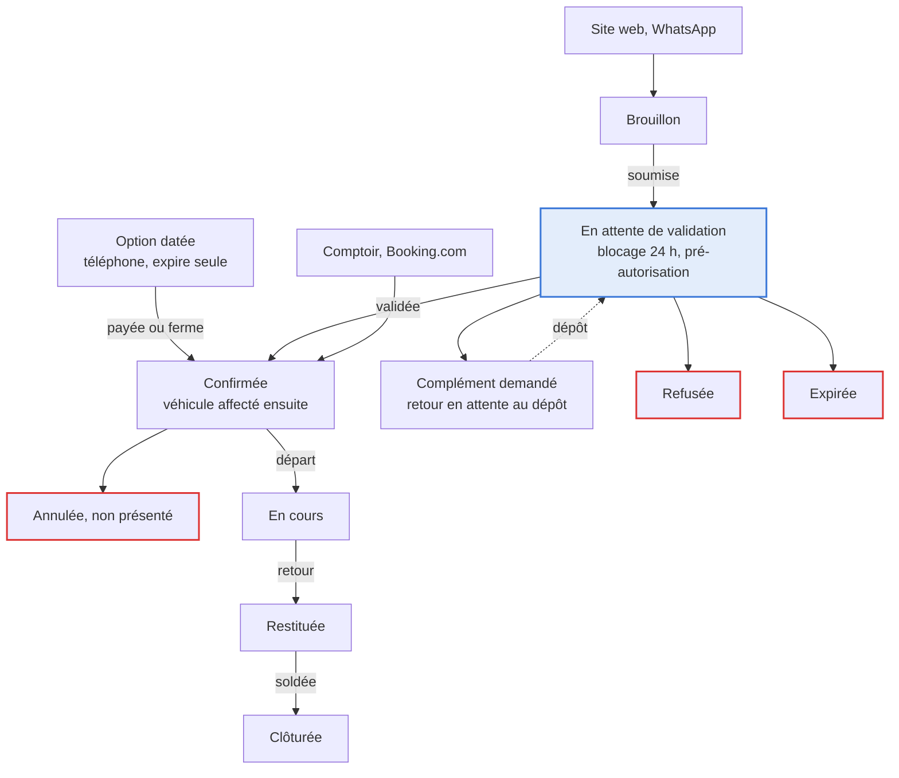
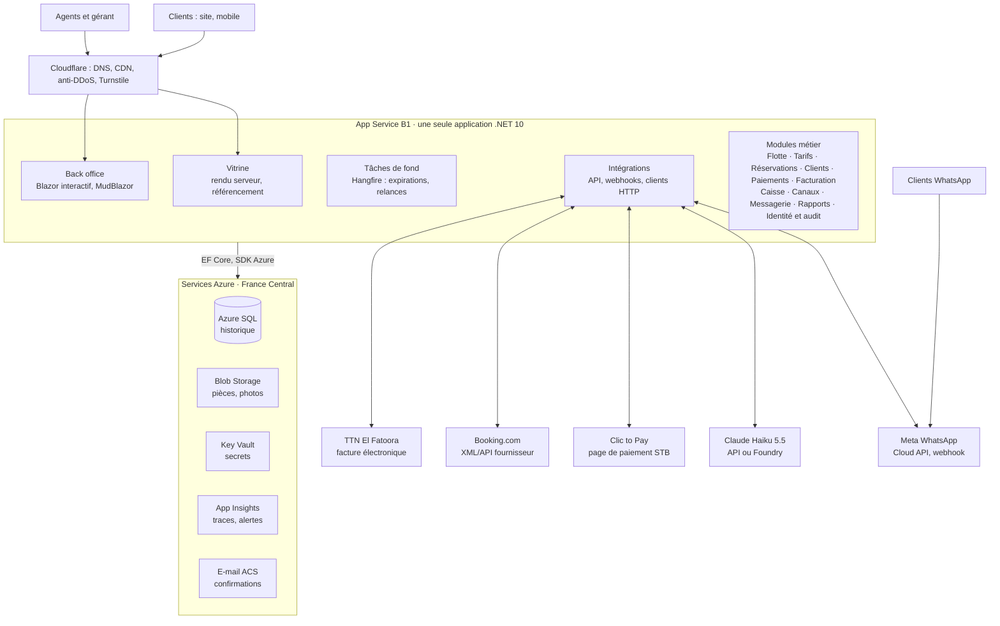

# Plateforme de location de voitures — Spécifications

> **Version 1 — 20 octobre 2026 — @Omar.**
> Transcription en Markdown du document d'origine [specifications-2026-10-20.pdf](specifications-2026-10-20.pdf), qui reste la référence figée de cette version. Les décisions à obtenir et les points à confirmer sont suivis dans [points-ouverts.md](points-ouverts.md), les décisions d'architecture dans [adr/](adr/README.md).

## Sommaire

1. [Résumé et décisions clés](#1-résumé-et-décisions-clés)
2. [Contexte, objectifs et indicateurs de succès](#2-contexte-objectifs-et-indicateurs-de-succès)
3. [Périmètre, acteurs et rôles](#3-périmètre-acteurs-et-rôles)
4. [Concepts métier et cycle de vie d'un dossier](#4-concepts-métier-et-cycle-de-vie-dun-dossier)
5. [Vitrine et tunnel de réservation](#5-vitrine-et-tunnel-de-réservation)
6. [Back office — exploitation](#6-back-office--exploitation)
7. [Flotte, tarification et disponibilité](#7-flotte-tarification-et-disponibilité)
8. [Finance et pilotage](#8-finance-et-pilotage)
9. [Intégration Clic to Pay](#9-intégration-clic-to-pay)
10. [Booking.com et gestionnaire de canaux](#10-bookingcom-et-gestionnaire-de-canaux)
11. [Agent IA WhatsApp](#11-agent-ia-whatsapp)
12. [Architecture technique et hébergement Azure](#12-architecture-technique-et-hébergement-azure)
13. [Modèle de données et API](#13-modèle-de-données-et-api)
14. [Sécurité, traçabilité et conformité](#14-sécurité-traçabilité-et-conformité)
15. [Plan de livraison et tests](#15-plan-de-livraison-et-tests)
16. [Améliorations proposées](#16-améliorations-proposées)
17. [Points ouverts à valider avec l'agence](#17-points-ouverts-à-valider-avec-lagence)
18. [Sources](#18-sources)

---

## 1. Résumé et décisions clés

Une seule application .NET 10 sur Azure, pour environ 20 à 35 USD par mois d'infrastructure, couvre site, back office, paiement Clic to Pay, bot WhatsApp et connexion Booking.com. La livraison se fait en six lots sur environ 20 semaines, avec l'exploitation interne en service dès la semaine 7.

| Sujet | Décision | Pourquoi |
|---|---|---|
| Architecture | Monolithe modulaire .NET 10 (LTS), monorepo, une seule application web | 30 véhicules : simplicité, coût, un seul déploiement |
| Front | Blazor : vitrine en rendu serveur, back office interactif avec MudBlazor | Référencement sans serveur Node, un seul langage |
| Données | Azure SQL (Basic puis S0), tables temporelles, Blob Storage privé | Traçabilité native, coût bas |
| Hébergement | App Service B1 Linux en France Central, Cloudflare Free devant | Le plus petit plan toujours actif |
| Vente | Par catégorie ACRISS, véhicule affecté ensuite | Standard des comparateurs, moins d'annulations |
| Paiement | Clic to Pay : pré-autorisation à la demande, capture à la validation | Demandes garanties, refus sans remboursement |
| Booking.com | Candidature fournisseur, puis module Canaux en XML/API | Aucune API publique ne permet de publier une flotte |
| WhatsApp | Cloud API directe, Claude Haiku 5.5 avec outils, jamais de réservation directe | Prix réels uniquement, coût IA marginal |
| Conformité | Facture électronique TTN, contribution de 2 TND par jour, autorisation INPDP | Obligations en vigueur en 2026 |

Cinq démarches de l'agence conditionnent le calendrier et doivent partir dès la semaine 1 : candidature fournisseur Booking.com, dossier INPDP, adhésion à la facturation électronique TTN, contrat Clic to Pay avec pré-autorisation, vérification de l'entreprise chez Meta.

---

## 2. Contexte, objectifs et indicateurs de succès

L'agence (30 véhicules, Tunisie) veut une plateforme unique qui centralise toutes ses locations — site, téléphone, comptoir, WhatsApp et Booking.com — avec une traçabilité complète et un hébergement Azure à coût minimal.

### Ce que dit le besoin

- Une vitrine simple, mobile d'abord, orientée réservation, et un back office complet (exploitation, comptabilité, rapports).
- Un dossier de location compte un conducteur principal et, en option, un conducteur secondaire.
- Chaque conducteur fournit une pièce d'identité (CIN s'il est tunisien, passeport s'il est étranger) et son permis de conduire.
- L'agent définit les tarifs de chaque véhicule et une règle saisonnière ; il valide les demandes web avant l'envoi d'une confirmation par e-mail.
- Paiement en ligne par Clic to Pay ; diffusion sur Booking.com ; agent IA sur WhatsApp qui renvoie vers une recherche pré-remplie du site.
- Back end .NET, front au choix, monorepo et une seule application web si possible.

### Objectifs mesurables (cibles proposées, à valider avec l'agence)

| Objectif | Indicateur | Cible proposée |
|---|---|---|
| Aucune surréservation | Conflits de planning acceptés par le système | 0 (contrôle bloquant) |
| Traiter vite les demandes web | Délai médian entre demande et décision | < 2 h ouvrées |
| Saisir vite au téléphone | Durée de création d'un dossier par un agent | < 2 min |
| Réserver vite sur mobile | Étapes du tunnel / durée médiane | 3 étapes / < 3 min |
| Tout tracer | Actions métier journalisées (qui, quand, quoi, canal) | 100 % |
| Piloter la rentabilité | Marge par véhicule disponible chaque mois | Rapport mensuel automatique |
| Maîtriser les coûts | Infrastructure Azure hors usage variable | ≈ 20 à 35 € par mois |

**Hypothèses de départ :** une seule agence au lancement (modèle prêt pour plusieurs), prix affichés en TND TTC, site en français et en anglais, arabe (sens droite-gauche) préparé dès l'architecture.

---

## 3. Périmètre, acteurs et rôles

La plateforme couvre tout le cycle d'une location — de la recherche du client à la clôture comptable — pour quatre profils internes, deux profils clients et six systèmes externes.

**Dans le périmètre :** vitrine publique, tunnel de demande, espace « Ma réservation », back office complet (demandes, dossiers, planning, flotte, tarifs, départs et retours, paiements, cautions, factures, caisse, dépenses, maintenance, rapports, paramétrage), intégrations Clic to Pay, Booking.com, WhatsApp avec IA, e-mail et facturation électronique.

**Hors périmètre (V1) :** comptabilité générale complète (bilan, liasse fiscale : restent chez l'expert-comptable, alimenté par des exports), paie, télématique GPS, application mobile native (le site responsive suffit, une PWA reste possible).

| Acteur | Ce qu'il fait | Accès |
|---|---|---|
| Client web | Cherche, demande, dépose ses documents, paie, suit sa réservation | Vitrine + lien « Ma réservation » |
| Client WhatsApp | Échange avec l'agent IA, reçoit un lien de réservation pré-rempli | WhatsApp |
| Agent de location | Valide les demandes, crée les dossiers téléphone et comptoir, fait départs et retours, encaisse | Back office |
| Gérant | Tarifs, saisons, flotte, utilisateurs, paramètres, rapports | Back office complet |
| Comptable | Factures, caisse, rapprochements, exports, clôtures mensuelles | Back office finance |
| Préparateur / mécanicien | Planning du jour, états des lieux, maintenance | Back office restreint, sur mobile |
| Systèmes externes | Clic to Pay, Booking.com, Meta WhatsApp, fournisseur IA, e-mail, Tunisie TradeNet | API sécurisées |

### Matrice des droits par défaut

Les rôles sont des préréglages de permissions fines : la permission « Tarification » peut être confiée à un agent, comme le prévoit le besoin. Chaque utilisateur a son propre compte avec double authentification ; aucun compte partagé, sinon la traçabilité ne vaut rien.

| Fonction | Agent | Gérant | Comptable | Préparateur |
|---|---|---|---|---|
| Valider ou refuser une demande web | Gérer | Gérer | Lire | — |
| Créer ou modifier un dossier | Gérer | Gérer | Lire | Lire |
| Tarifs, saisons, promotions | Sur permission | Gérer | Lire | — |
| Flotte, échéances, maintenance | Lire | Gérer | Lire | Gérer la maintenance |
| Départ et retour (états des lieux) | Gérer | Gérer | — | Gérer |
| Encaissements et cautions | Gérer | Gérer | Gérer | — |
| Factures et avoirs | Émettre | Gérer | Gérer | — |
| Clôture de caisse | Sa caisse | Gérer | Gérer | — |
| Rapports | Tableau du jour | Gérer | Gérer | — |
| Utilisateurs et paramètres | — | Gérer | — | — |
| Images des pièces d'identité | Lire (journalisé) | Lire (journalisé) | — | — |

---

## 4. Concepts métier et cycle de vie d'un dossier

Le dossier de location est l'objet central : il naît par l'un des cinq canaux, suit un seul cycle de vie, et chaque transition est horodatée et attribuée à une personne ou à un système.

| Terme | Définition retenue |
|---|---|
| Dossier de location | La réservation puis le contrat : canal d'origine, dates et lieux, catégorie, véhicule affecté, conducteurs, devis figé, paiements, caution, chronologie |
| Catégorie (code ACRISS) | Groupe de véhicules équivalents, par exemple ECMR = économique, 2/4 portes, manuelle, climatisée. On vend une catégorie « ou similaire » ; l'agent affecte le véhicule. Option payante : modèle garanti |
| Véhicule | Une immatriculation rattachée à une catégorie, avec kilométrage et échéances (assurance, vignette, visite technique) |
| Conducteur principal / secondaire | Personne qui conduit, avec sa pièce (CIN si tunisien, passeport sinon) et son permis. Le payeur peut être une société |
| Blocage temporaire (hold) | Capacité réservée pendant la validation d'une demande, 24 h par défaut, libérée automatiquement à expiration |
| Devis figé | Détail ligne à ligne du prix calculé à la demande ; il ne change plus, sauf avenant explicite et tracé |
| Acompte / caution | L'acompte paie une part de la location ; la caution garantit les dommages et frais, puis elle est restituée ou retenue en partie |
| État des lieux | Constat au départ et au retour : photos, kilométrage, carburant, dommages sur schéma, signatures |

### Cycle de vie : cinq canaux, un seul cycle



Toutes les entrées convergent vers « Confirmée » ; seule la demande web passe par la validation de l'agent, et chaque issue sans location (en rouge) libère la capacité.

### Règles par canal

| Canal | Création | Confirmation | Documents | Paiement |
|---|---|---|---|---|
| Site web | Le client soumet une demande | L'agent valide, e-mail de confirmation automatique | Photos déposées par le client | Pré-autorisation Clic to Pay à la demande, capturée à la validation |
| WhatsApp | Le bot ne crée rien : il envoie un lien de recherche pré-rempli | Comme le site, avec la source « WhatsApp » | Comme le site | Comme le site |
| Téléphone | L'agent crée une option datée ou une réservation confirmée | Immédiate ou à réception du paiement | Saisis par l'agent, ou lien de dépôt envoyé au client | Lien de paiement Clic to Pay, ou paiement au comptoir |
| Comptoir | L'agent crée puis fait le départ | Immédiate | Scannés ou photographiés par l'agent | Caisse : espèces, TPE, chèque |
| Booking.com | Réservation reçue du canal | Instantanée (règle des distributeurs), contrôles au départ | Vérifiés au comptoir | Selon le contrat : prépayé au canal ou payé sur place ; commission tracée |

### Règles transverses

- Toute transition passe par une commande métier unique qui enregistre qui, quand, depuis quel canal, et alimente la chronologie du dossier.
- Une demande non traitée avant la fin du blocage passe en « Expirée », libère la capacité et annule la pré-autorisation.
- Un changement de dates ou de catégorie repasse toujours par le moteur de disponibilité et produit un avenant au devis.
- Le motif est obligatoire pour un refus, une annulation, un non-présenté ou une remise manuelle.

---

## 5. Vitrine et tunnel de réservation

Le site va droit au but : une recherche dès la page d'accueil, le prix total du séjour affiché tout de suite, une réservation en trois étapes sans création de compte.

### Principes d'expérience

- Mobile d'abord ; pages rendues côté serveur pour la vitesse et le référencement ; objectif LCP < 2,5 s en 4G.
- Prix total TTC du séjour dans les résultats (prix par jour en secondaire) ; options, contribution journalière et caution visibles avant le paiement.
- Aucun compte client : « Ma réservation » s'ouvre par un lien magique envoyé par e-mail ou un code à usage unique.
- Bouton WhatsApp sur toutes les pages ; français et anglais au lancement, arabe (droite-gauche) prêt ; accessibilité WCAG 2.2 AA.

La diaspora tunisienne pèse environ 80 % de la demande estivale, avec un pic du 18 au 20 juillet (Tuniscope) : parcours en français prioritaire, prix en TND avec équivalent en euros indicatif, et acceptation des cartes étrangères par Clic to Pay à confirmer avec la banque.

### Écrans

| Écran | Contenu essentiel |
|---|---|
| Accueil | Recherche (lieu, date et heure de départ et de retour, retour ailleurs), trois arguments, catégories phares, avis réels, FAQ courte |
| Résultats | Catégories disponibles : photo, places, bagages, boîte, prix total ; filtres boîte automatique et nombre de places ; tri par prix |
| Étape 1 — Options | Rachat de franchise, conducteur additionnel, siège enfant, livraison hôtel ou aéroport ; récapitulatif mis à jour en direct |
| Étape 2 — Conducteurs | Identité, nationalité (qui impose CIN ou passeport), date de naissance, permis ; photos recto-verso prises au téléphone ; second conducteur optionnel |
| Étape 3 — Paiement | Conditions générales à accepter, montant garanti, redirection vers Clic to Pay |
| Confirmation | « Demande reçue, réponse sous 2 h ouvrées », puis e-mail et message WhatsApp si le client y a consenti |
| Ma réservation | Statut, documents manquants, paiement du solde, annulation selon les conditions, contrat et facture en PDF |
| Pages fixes | Agence et contact, FAQ, conditions générales de location, confidentialité |

### Recherche personnalisée et liens profonds

Toute recherche est une URL partageable, utilisée par le bot WhatsApp, l'agent au téléphone et les campagnes :

```text
/fr/reserver?lieu=TUN&depart=2027-07-01T10:00&retour=2027-07-05T10:00&cat=ECMR&boite=auto&places=5&devis=Q7F3K2&src=whatsapp
```

Le paramètre `devis` charge un devis verrouillé 24 h créé par le bot ; `src` et les paramètres UTM attribuent la vente à son canal. Le serveur recalcule toujours prix et disponibilité : rien de ce que porte l'URL n'est cru sur parole.

### Règles du tunnel

**Éligibilité (paramétrable).** Âge minimum et ancienneté du permis — 21 ans et 2 ans sont l'usage courant en Tunisie (Auto Europe) —, supplément jeune conducteur, pièces valides jusqu'à la date de retour, permis international exigé si le permis n'est pas en caractères latins.

**Dépôt des documents.** JPG, PNG ou PDF jusqu'à 10 Mo ; photo compressée sur le téléphone (environ 1 600 px) pour économiser les données mobiles ; stockage privé et chiffré ; consentement explicite avec mention de la finalité.

**Anti-abus et mesure.** Cloudflare Turnstile (gratuit) à la soumission, limitation de débit, liste noire appliquée sans le signaler au demandeur. Chaque étape émet un événement (recherche, résultats, options, documents, paiement, confirmation) pour mesurer la conversion par canal.

---

## 6. Back office — exploitation

Le back office est pensé pour le comptoir : tableau du jour, file des demandes et planning tiennent chacun sur un écran, et une réservation téléphonique se saisit en moins de deux minutes.

**Tableau du jour.** Départs et retours du jour (heure, client, véhicule, état des documents et du paiement), demandes à valider avec leur compte à rebours, alertes (échéance d'assurance ou de visite technique, véhicule non préparé, retour en retard, caution non restituée), encaissements de la journée.

**File des demandes web.** Pour chaque demande, le système pré-remplit une liste de contrôle que l'agent confirme :

- [ ] Documents présents et lisibles, noms identiques sur la pièce, le permis et la demande
- [ ] Âge et ancienneté du permis conformes, pièces valides jusqu'à la date de retour
- [ ] Client absent de la liste noire
- [ ] Disponibilité toujours confirmée, pré-autorisation Clic to Pay obtenue

Trois actions :

- **Valider** : capture du paiement, affectation proposée, e-mail et WhatsApp de confirmation.
- **Demander un complément** : motif prédéfini, lien de dépôt, blocage prolongé.
- **Refuser** : motif obligatoire, pré-autorisation annulée, e-mail.

Une demande qui dépasse son délai remonte au gérant.

**Création rapide (téléphone et comptoir).** Un seul formulaire : dates, lieu et catégorie donnent aussitôt disponibilité et prix ; le client est retrouvé par téléphone, CIN, passeport ou e-mail, sans doublon. L'agent choisit option datée, lien de paiement ou encaissement. Il peut aussi envoyer au client un lien « compléter mon dossier » pour qu'il dépose lui-même ses pièces.

**Planning de la flotte.** Grille véhicules × jours (vues semaine et mois) : barres colorées par statut, réservations non affectées regroupées par catégorie, glisser-déposer pour affecter ou réaffecter, blocages de maintenance et tampon de préparation visibles. Le serveur refuse tout chevauchement, même si l'écran le permet.

**Clients et conducteurs.** Une fiche par personne : coordonnées, nationalité, pièces (type, numéro, pays, dates, images recto-verso, vérifiée par qui et quand), historique, incidents, amendes, notes, liste noire motivée, consentements. Une pièce encore valide se réutilise d'une location à l'autre. Un payeur société porte raison sociale, matricule fiscal et adresse de facturation.

**Départ.** Sur tablette ou téléphone : contrôle des originaux, affectation du véhicule, état des lieux guidé (8 photos minimum, kilométrage, carburant, accessoires, dommages pointés sur un schéma), encaissement du solde, prise de caution (empreinte TPE, espèces, chèque), contrat PDF signé à l'écran par le client et l'agent, envoyé par e-mail ou WhatsApp. Le dossier passe « En cours ».

**Retour.** Kilométrage, carburant et photos ; nouveaux dommages comparés côte à côte avec le départ ; frais calculés (kilomètres, carburant, retard au-delà de la tolérance, nettoyage, dommages plafonnés à la franchise) ; facture finale ; caution restituée ou retenue avec justificatif. Le dossier passe « Restituée », puis « Clôturée » quand tout est soldé.

**Prolongation, modification, annulation.** Une prolongation contrôle la disponibilité, valorise les jours ajoutés au tarif du moment et produit un avenant. L'annulation suit une politique paramétrable (gratuite jusqu'à J-x, puis frais) et génère remboursement ou avoir. Le non-présenté se déclenche après un délai paramétrable.

**Amendes et sinistres.** Un PV saisi (date, heure, lieu, immatriculation) retrouve automatiquement le dossier et le conducteur à cet instant, puis produit la fiche de désignation et la refacturation éventuelle. Un sinistre réunit constat, photos, assureur, franchise, coûts et remboursements, rattachés au dossier et au véhicule.

---

## 7. Flotte, tarification et disponibilité

Le prix se calcule jour par jour selon la saison de chaque jour, puis s'appliquent durée, options et taxes ; la disponibilité se vérifie par catégorie, sous verrou, pour qu'aucun canal ne vende deux fois la même voiture.

### Flotte

- **Fiche véhicule** : immatriculation, modèle, catégorie ACRISS, boîte, carburant, places, bagages, photos, kilométrage, date de mise en circulation, statut (actif, maintenance, hors service, vendu).
- **Échéances** : assurance, vignette, visite technique, carte grise ; alertes à J-30, J-15 et J-7. Un véhicule ne peut pas partir pour une location qui dépasse une échéance, sauf dérogation tracée du gérant.
- **Entretien planifié** (vidange tous les X km ou X mois, pneus, freins) avec blocage automatique dans le planning.
- **Données économiques** : prix et date d'achat, financement (comptant, crédit, leasing et loyers), amortissement, valeur résiduelle et coûts, pour calculer la rentabilité de chaque véhicule.

### Règles du moteur de prix (toutes paramétrables)

1. Unité de 24 h depuis l'heure de départ ; au-delà d'une tolérance de retard (59 min par défaut), un jour s'ajoute.
2. Prix de base par catégorie, saisi TTC ; prix par véhicule pour l'option « modèle garanti ».
3. Saisons datées (basse, moyenne, haute) et événements prioritaires (Aïd, fin d'année, festivals) : chaque jour prend le prix de sa période.
4. Paliers de durée appliqués à tout le séjour : 1–2, 3–6, 7–13, 14–29, 30 jours et plus.
5. Durée minimale par période, par exemple 3 jours en haute saison.
6. Options par jour avec plafond, ou au forfait : conducteur additionnel, jeune conducteur, livraison par lieu, hors horaires, aller simple.
7. Rachat de franchise par jour ; caution par catégorie, réduite en cas de rachat.
8. Kilométrage illimité ou plafond par jour avec prix du km supplémentaire ; carburant plein/plein avec frais de remise à niveau.
9. Promotions : code, réservation anticipée, long séjour ; non cumulables sauf paramètre contraire.
10. Prix par canal : grille ou majoration (Booking.com) pour absorber la commission, ou parité.
11. Taxes : TVA au taux normal de 19 % (à confirmer par l'expert-comptable) ; contribution de 2 TND par jour et par véhicule loué, due depuis le 1er janvier 2026, à la charge du client, incluse dans la base de TVA et reversée chaque mois (note générale n°7, Webdo) ; droit de timbre sur facture selon le barème en vigueur.
12. Calculs au millime (3 décimales) ; prix publics arrondis au dinar.
13. Devis figé ligne par ligne ; seul un avenant explicite recalcule. Tout changement de grille est historisé, et un simulateur permet de tester une grille avant publication.

### Exemple chiffré (tarifs illustratifs)

Catégorie ECMR, du 28/06/2027 10:00 au 03/07/2027 10:00, soit 5 jours ; 110 TND/jour en moyenne saison jusqu'au 30/06, 140 TND/jour en haute saison dès le 01/07 ; remise de 5 % pour 3 à 6 jours ; conducteur additionnel 10 TND/jour ; siège enfant 8 TND/jour.

| Ligne | Calcul | Montant (TND) |
|---|---|---:|
| Jours en moyenne saison | 3 × 110,000 | 330,000 |
| Jours en haute saison | 2 × 140,000 | 280,000 |
| Remise palier 3–6 jours | −5 % × 610,000 | −30,500 |
| Conducteur additionnel | 5 × 10,000 | 50,000 |
| Siège enfant | 5 × 8,000 | 40,000 |
| Contribution journalière | 5 × 2,000 HT + TVA 19 % | 11,900 |
| **Total TTC** | | **681,400** |
| dont HT / TVA | 562,605 + 10,000 / 108,795 | 572,605 / 108,795 |

Cet exemple devient un test automatisé du moteur de prix. Pour repère, les prix publiés en 2026 vont de 120 à 150 TND par jour pour une économique (Tuniscope).

### Disponibilité et anti-surréservation

- On vend des catégories. La capacité d'une catégorie à un instant donné compte ses véhicules actifs, hors maintenance et hors échéance dépassée.
- L'occupation compte les dossiers actifs (demande sous blocage, option, confirmée, en cours) qui chevauchent cet instant, tampon de préparation inclus (2 h après chaque retour, par défaut).
- Une période est disponible si, à chaque instant, l'occupation plus un reste inférieure ou égale à la capacité. Avec des véhicules interchangeables, cette condition garantit qu'une affectation existe ; un algorithme glouton la propose, l'agent peut la modifier.
- Quotas et arrêt des ventes par canal et par catégorie, par exemple garder 2 véhicules hors Booking.com en haute saison.
- Toute création ou modification s'exécute dans une transaction avec verrou applicatif par catégorie (`sp_getapplock`) : le second demandeur reçoit « plus disponible », jamais une surréservation.
- Booking.com et le bot lisent un cache mémoire des disponibilités, invalidé à chaque changement de dossier ou de flotte.

---

## 8. Finance et pilotage

Le progiciel couvre la pré-comptabilité — encaissements, cautions, factures, caisse, dépenses, écritures — et laisse la comptabilité générale à l'expert-comptable, alimenté par des exports propres.

**Paiements et cautions.** Moyens : Clic to Pay (en ligne ou par lien), TPE, espèces, chèque, virement, prépayé par le canal. Chaque mouvement porte un statut (en attente, pré-autorisé, encaissé, annulé, remboursé, échoué), une référence externe et un utilisateur. La politique de garantie se règle par canal et par saison : aucune, acompte en %, totalité. La caution est une dette envers le client, jamais un revenu : montant par catégorie, mode (empreinte TPE, espèces, chèque), statut (bloquée, restituée, retenue partielle).

**Facturation électronique obligatoire.** Depuis le 1er janvier 2026, l'article 53 de la loi de finances 2026 impose la facture électronique aux prestataires de services ; les prestataires ayant déposé leur demande d'adhésion peuvent émettre des factures papier en attendant de finaliser leurs démarches (note générale n°2/2026, Tuniscope). Les factures transitent par Tunisie TradeNet au format XML national TEIF, signées électroniquement (Banqup). Une facture papier émise à la place d'une facture électronique coûte 100 à 500 TND d'amende par facture (La Presse). Le système doit donc :

- numéroter sans trou par exercice et porter toutes les mentions obligatoires (dont les matricules fiscaux) ;
- rendre une facture émise immuable : toute correction passe par un avoir ;
- produire le XML TEIF, le faire signer, le transmettre à TTN et conserver la référence unique retournée ;
- garder un mode « papier transitoire » activable tant que l'adhésion TTN de l'agence n'est pas finalisée.

La note précise aussi qu'un contrat remplissant les conditions légales peut tenir lieu de facture : à faire trancher par l'expert-comptable pour le contrat de location.

**Caisse.** Une session par agent et par jour : fonds de caisse, entrées et sorties typées, comptage de clôture, écart justifié, verrouillage. Les cautions en espèces sont suivies à part.

**Dépenses.** Carburant, entretien, réparations, assurance, vignette, loyers de leasing, commissions (Booking.com, Clic to Pay), loyer, charges ; justificatif photographié ; rattachement au véhicule quand c'est possible.

**Rapprochements.** Transactions Clic to Pay contre paiements enregistrés, versements Booking.com contre réservations et commissions, caisse contre encaissements.

**Pré-comptabilité.** Journaux des ventes, achats, banque et caisse ; plan de comptes paramétrable (système comptable tunisien) avec correspondance par type d'opération ; TVA collectée et contribution journalière sur comptes dédiés ; export CSV ou Excel au format convenu avec l'expert-comptable ; clôture mensuelle qui verrouille la période.

### Indicateurs de pilotage

| Indicateur | Définition | Sert à |
|---|---|---|
| Revenu par véhicule disponible et par jour | CA location / (véhicules × jours) | Indicateur principal du gérant |
| Taux d'utilisation | Jours loués / jours disponibles | Dimensionner la flotte |
| Prix moyen par jour loué | CA location / jours loués | Suivre le positionnement prix |
| Marge par véhicule | Revenus − coûts directs − amortissement | Décider vente ou remplacement |
| CA et marge par canal | Après commissions | Arbitrer Booking.com contre la vente directe |
| Carnet à 30, 60 et 90 jours | Jours déjà vendus par catégorie | Ajuster les prix à l'avance |
| Conversion du site et du bot | Recherches → demandes → confirmées | Améliorer le tunnel et le bot |
| Délai de validation, taux de refus | Médiane, pourcentage | Qualité de service |
| Annulations et non-présentés | Pourcentage par canal | Régler la politique de garantie |
| Encaissé, facturé, cautions ouvertes, impayés | Montants | Trésorerie |

Les rapports s'appuient sur des vues SQL et un instantané quotidien (une ligne par véhicule et par jour) ; graphiques dans le back office, exports Excel, et branchement Power BI possible plus tard sans refonte.

---

## 9. Intégration Clic to Pay

Clic to Pay s'intègre par redirection vers sa page de paiement hébergée : l'agence ne voit ni ne stocke aucun numéro de carte, et chaque paiement est confirmé par un appel de serveur à serveur.

La documentation officielle est remise par la banque ou SMT à l'ouverture du compte marchand. Les éléments ci-dessous viennent d'un SDK public non officiel (machour/clictopay) et de la documentation de la passerelle sous-jacente (BPC) ; ils sont à confirmer en recette.

| Opération | Point d'API | Usage dans la plateforme |
|---|---|---|
| Paiement en une étape | `register.do` | Lien de paiement après validation, solde, paiement par lien au téléphone |
| Pré-autorisation | `registerPreAuth.do` | Garantie posée à la soumission d'une demande web |
| Capture | `deposit.do` | Encaissement à la validation par l'agent, montant égal ou inférieur |
| Annulation | `reverse.do` | Refus ou expiration d'une demande |
| Remboursement | `refund.do` | Annulation client, trop-perçu ; validation du gérant au-delà d'un seuil |
| Statut détaillé | `getOrderStatusExtended.do` | Seule source de vérité sur l'état d'un paiement |

- Environnement de test : `https://test.clictopay.com/payment/rest/` ; l'URL de production et les identifiants API sont fournis par SMT.
- Montant en unité minimale de la devise. Le TND a 3 décimales, donc en millimes (× 1 000) ; le SDK cité est ambigu sur ce point, d'où un paiement test de 1,000 TND à faire dès la recette.
- Statuts de commande : 0 enregistrée, 1 pré-autorisée, 2 débitée ; les autres codes (annulée, remboursée, refusée) sont à reprendre de la documentation SMT.

### Flux d'une demande web

1. À la soumission : `registerPreAuth.do` avec un numéro de commande interne unique (idempotence), les URL de retour et d'échec, la langue ; redirection du client vers la page Clic to Pay.
2. Au retour du client : le serveur appelle `getOrderStatusExtended.do` ; les paramètres de l'URL de retour ne prouvent rien.
3. Validation par l'agent : `deposit.do`. Refus ou expiration : `reverse.do`.
4. Une tâche relit toutes les 15 minutes les paiements en attente, pour rattraper les clients qui ferment l'onglet avant le retour.
5. Rapprochement quotidien avec le relevé marchand ; chaque appel est journalisé sans donnée sensible.

**Plan de repli.** Si la pré-autorisation n'est pas activée sur le compte marchand, le client paie après validation via un lien `register.do` valable 24 h ; le dossier reste « Validée, en attente de paiement » et sa capacité reste bloquée jusque-là.

**Caution.** La durée de vie d'une pré-autorisation est fixée par la banque émettrice : à confirmer avec SMT. D'ici là, la caution se prend au comptoir sur TPE et s'enregistre dans le dossier.

**Prérequis côté agence.** Contrat commerçant e-commerce avec la STB, activation du paiement en deux étapes, identifiants de test et de production, commission par transaction négociée.

---

## 10. Booking.com et gestionnaire de canaux

Booking.com n'offre pas d'API publique pour publier une flotte : l'agence doit d'abord être acceptée comme fournisseur de location, puis se connecter en XML/API selon les spécifications remises à l'intégration.

**Ce que Booking.com demande.** Le formulaire « Register Interest to become a car rental partner » (marketplace.rentalcars.com) filtre sur trois points : agences physiques à l'enseigne, société en activité et immatriculée à la TVA, utilisation d'un logiciel XML/API. Il demande ensuite taille et âge de la flotte, nombre et type d'agences (aéroport, centre-ville…) et des photos des agences. La Tunisie figure parmi les destinations proposées. Rentalcars.com, filiale de Booking, dispose aussi d'un extranet fournisseur.

**Ce qui ne convient pas.** La Demand API de Booking.com sert aux affiliés qui revendent l'inventaire de Booking : elle ne permet pas de publier sa propre flotte.

### Deux voies de connexion

| Voie | Principe | À retenir |
|---|---|---|
| Connecteur maison | La plateforme devient le « logiciel XML/API » de l'agence, développé et certifié selon le cahier des charges remis par Booking | Pas d'abonnement tiers ; délai de certification à prévoir |
| Fournisseur de connectivité | Un intermédiaire déjà intégré relaie disponibilités et réservations | Mise en ligne plus rapide ; abonnement ou commission en plus |

### Architecture du module Canaux

Un modèle interne unique de disponibilités, tarifs et quotas, et un adaptateur par canal, pour brancher plus tard d'autres comparateurs sans toucher au cœur.

- **Entrant**, si le canal interroge l'agence en temps réel : disponibilité et tarif, création, modification, annulation, consultation. Réponse en moins d'une seconde depuis le cache.
- **Sortant**, si le canal attend des envois : publication des tarifs, disponibilités et arrêts de vente à chaque changement, plus une resynchronisation complète chaque nuit.
- **Correspondances** : catégories ↔ codes ACRISS, lieux ↔ codes du canal (aéroports TUN, NBE, MIR, DJE…), options, assurances et frais ↔ listes de codes du secteur. Le standard de fait est OpenTravel Alliance, dont les listes couvrent frais, couvertures et équipements (Car Rental Gateway).
- **Fiabilité** : référence canal unique (idempotence), journal de chaque message entrant et sortant, alerte et file de rejeu en cas d'échec.
- **Réservations reçues** : statut « Confirmée », référence canal, mode de paiement (prépayé au canal ou sur place), prix brut, commission et net ; rapprochement mensuel avec les factures et versements du canal.

**En attendant l'API.** L'agence gère ses tarifs sur l'extranet ; chaque réservation reçue est saisie dans le back office avec la source « Booking.com », et le planning signale les arrêts de vente à reporter sur l'extranet.

**À lancer dès le démarrage** : candidature fournisseur, négociation du contrat (commission, annulation, carburant, assurances), puis obtention du cahier des charges technique. Ce délai ne dépend pas du développement.

---

## 11. Agent IA WhatsApp

Le bot accueille, qualifie le besoin, interroge les vraies disponibilités et renvoie un lien de réservation pré-rempli ; il ne confirme jamais une location lui-même et passe la main à un agent dès que nécessaire.

**Règles Meta à respecter.** Depuis le 15 janvier 2026, l'API WhatsApp Business interdit les assistants IA généralistes ; l'IA mise au service de l'activité de l'entreprise (support, réservation) reste autorisée (respond.io). Le bot reste donc strictement centré sur la location.

**Coût Meta depuis le 1er octobre 2026.** Chaque réponse libre (« message de service »), qu'elle vienne d'un humain ou d'une IA tierce, est facturée au-delà de 1 000 messages gratuits par mois et par numéro ; les modèles « utilité » envoyés dans la fenêtre de 24 h sont aussi facturés ; les messages du client restent gratuits ; la Tunisie relève du tarif « Rest of Africa » (Meta, tarifs officiels). Conséquence de conception : une réponse complète par tour plutôt que trois petites, et des messages interactifs (boutons, listes) pour réduire les allers-retours.

### Architecture

- WhatsApp Business Platform en Cloud API directe (sans intermédiaire, donc sans marge), numéro dédié, entreprise vérifiée par Meta.
- Webhook dans la même application : vérification de la signature `X-Hub-Signature-256`, réponse 200 immédiate, traitement asynchrone par file.
- Modèle : Claude Haiku 5.5 via le SDK C# officiel `Anthropic`, qui implémente `IChatClient` de Microsoft.Extensions.AI (doc SDK C#). Il est aussi disponible dans Microsoft Foundry (package `Anthropic.Foundry`), facturé sur l'abonnement Azure ; les déploiements y sont « Global » ou « US Data Zone », sans zone européenne (doc Foundry).
- Coût IA : 0,10 USD par million de jetons en entrée, 0,50 USD en sortie, 0,01 USD en lecture de cache (tarifs). Avec le prompt système et les outils en cache, on estime 2 à 5 USD pour 1 000 conversations : le poste principal sera Meta, pas l'IA.

### Outils donnés au modèle

| Outil | Rôle |
|---|---|
| `rechercher_disponibilites` | Catégories disponibles et prix totaux, calculés par le vrai moteur |
| `creer_lien_devis` | Devis verrouillé 24 h et lien profond vers le tunnel du site |
| `infos_agence` | Base de connaissances validée par le gérant : documents requis, caution, horaires, adresse, conditions |
| `statut_reservation` | Uniquement si le numéro WhatsApp correspond à celui du dossier |
| `transferer_a_un_agent` | Place la conversation dans la boîte partagée et coupe le bot |

**Parcours type.** Accueil dans la langue du client (français, arabe, darija, anglais) ; questions groupées (dates, lieu, passagers, bagages, boîte automatique) ; deux ou trois propositions avec prix total ; lien de réservation ; une seule relance si le lien n'est pas utilisé.

### Garde-fous

- Aucun prix ni disponibilité inventés : seulement ce que renvoient les outils, et le prix du site fait foi.
- Le bot ne promet jamais de confirmation ; il explique la validation par l'agent.
- Aucune pièce d'identité ni donnée de carte sur WhatsApp : le dépôt passe par le lien sécurisé.
- Refus poli hors sujet ; plafond de tours et de jetons par conversation ; colère, réclamation ou cas complexe entraînent un transfert humain.

**Boîte WhatsApp partagée.** Dans le back office : conversations, reprise en main par un agent (le bot se tait), réponse libre dans la fenêtre de 24 h et modèles approuvés au-delà, rattachement à un client ou un dossier, rétention limitée (12 mois par défaut).

**Notifications sortantes.** Modèles « utilité » approuvés par Meta : confirmation, rappel la veille avec l'adresse, rappel de retour, lien de paiement, demande d'avis. Le consentement est recueilli dans le tunnel.

**Mesure.** Conversations, liens envoyés et ouverts, réservations attribuées (paramètre `src`), taux de transfert, coût Meta et IA par réservation. Un jeu de 30 conversations de test (français, arabe, anglais) est rejoué à chaque modification du prompt.

---

## 12. Architecture technique et hébergement Azure

Une seule application .NET 10 (monolithe modulaire) sert la vitrine, le back office, les API d'intégration et les tâches de fond ; elle tourne sur un App Service B1 avec une base Azure SQL, pour environ 20 à 35 USD par mois d'infrastructure.



Clients et agents passent par Cloudflare ; WhatsApp, Claude, Clic to Pay, Booking.com et TTN ne parlent qu'au module d'intégration, et toutes les données restent dans les services Azure.

### Choix du front : Blazor (.NET 10) plutôt qu'un SPA séparé

- Vitrine en rendu serveur statique : HTML complet dès la première requête, référencement natif, aucun serveur Node à héberger, quelques lignes de JavaScript seulement (compression des photos, envoi automatique de formulaire).
- Back office en Blazor interactif côté serveur avec MudBlazor (licence MIT) : grilles, formulaires, dialogues ; appels directs aux services métier, sans API interne à maintenir.
- Un seul langage, des modèles et validations partagés, un seul build, un seul déploiement : exactement le monorepo à une application demandé.
- Alternative crédible : Angular pré-rendu, servi par la même application. Elle impose une API interne, des DTO en double et deux chaînes de build, pour un gain faible à cette échelle.

### Structure du monorepo

```text
/src
  CarRental.Web             hôte ASP.NET Core : vitrine (SSR), back office (/admin),
                            API d'intégration, webhooks, tâches
  CarRental.Application     cas d'usage par module : commandes, requêtes, règles
  CarRental.Domain          agrégats, objets valeur (Money en TND, Period),
                            événements, invariants
  CarRental.Infrastructure  EF Core / SQL, Blob, e-mail, Clic to Pay, WhatsApp,
                            Claude, TTN, Booking.com
/tests                      unitaires (prix, disponibilité), intégration (SQL réel
                            en conteneur), bout en bout (Playwright)
/infra                      Bicep
/docs                       spécifications, décisions d'architecture (ADR)
/.github/workflows          intégration et déploiement continus
```

Modules métier : Flotte, Tarifs, Réservations, Clients, Paiements, Facturation, Caisse et dépenses, Canaux, Messagerie, Rapports, Identité et audit. Des tests d'architecture vérifient qu'aucun module ne lit les tables d'un autre.

### Briques techniques

| Besoin | Choix | Raison |
|---|---|---|
| Données | EF Core 10 et Azure SQL, tables temporelles | Historique de chaque ligne, sans code |
| Tâches de fond | Hangfire sur SQL | Expirations, relances, synchronisations, avec reprises et tableau de bord |
| Fichiers | Azure Blob Storage privé | Pièces, photos d'états des lieux, PDF |
| PDF et Excel | QuestPDF, ClosedXML | Contrats, factures, exports ; vérifier le seuil de la licence gratuite QuestPDF |
| E-mail | Azure Communication Services Email | Domaine vérifié (SPF, DKIM, DMARC), coût marginal |
| IA | SDK `Anthropic` derrière `IChatClient` | Modèle et fournisseur interchangeables |
| Observabilité | OpenTelemetry vers Application Insights | Traces, journaux, alertes |
| Comptes internes | ASP.NET Core Identity, double authentification | Comptes individuels, traçabilité |

### Hébergement (région France Central, estimations à vérifier dans la calculatrice Azure)

| Ressource | Offre | Coût mensuel |
|---|---|---|
| App Service Linux | B1 : 1 cœur, 1,75 Go, toujours actif, certificat géré gratuit | ≈ 13 USD (Microsoft Q&A) |
| Azure SQL Database | Basic 5 DTU au départ, S0 10 DTU si besoin | ≈ 5 puis 15 USD, ordre de grandeur relevé en 2016 (SQLServerCentral) |
| Blob Storage, e-mail, Key Vault | À l'usage | < 3 USD |
| Application Insights | Quota gratuit, échantillonnage, plafond journalier | ≈ 0 |
| Recette | App Service gratuit (F1, sans SLA) et offre gratuite Azure SQL si elle est toujours proposée | 0 |
| Cloudflare Free | DNS, CDN, anti-DDoS, Turnstile | 0 |

S'y ajoutent les coûts variables : messages WhatsApp au-delà du quota gratuit, IA (quelques USD), commissions Clic to Pay et Booking.com.

**Limites assumées du B1.** Pas d'emplacements de déploiement : une mise en production redémarre l'application quelques secondes, donc elle se fait la nuit. Une seule instance suffit pour 30 véhicules ; passer à plusieurs instances exigerait Azure SignalR et un cache partagé, inutiles aujourd'hui.

**Livraison continue.** GitHub Actions : build, tests, analyse, migrations EF appliquées par bundle avant le déploiement, puis déploiement zip ; l'infrastructure se recrée à l'identique depuis les fichiers Bicep.

---

## 13. Modèle de données et API

Une quarantaine de tables couvrent tout le périmètre ; les API exposées se limitent à ce qu'appellent les partenaires (canaux, bot, banque, Meta), car le back office utilise directement les services métier.

| Module | Entités principales | Points clés |
|---|---|---|
| Référentiel | Agency, Location, Setting, User, Role, Permission | Lieux typés : agence, aéroport, point de livraison |
| Flotte | VehicleCategory, Vehicle, VehicleDocument, MaintenanceEvent, VehicleCost | Code ACRISS et caution sur la catégorie ; échéances datées |
| Tarifs | Season, RatePlan, Extra, Promotion, ChannelRate, TaxRule | Grille catégorie × saison × palier ; taxes paramétrables |
| Clients | Customer, Person, IdentityDocument, Consent, BlacklistEntry | Pièce typée CIN, passeport, permis ou permis international ; vérifiée par qui et quand |
| Réservations | Booking, BookingDriver, Quote, QuoteLine, BookingEvent, Inspection, Damage, RentalContract | Numéro `LOC-2027-000123`, source, référence canal, fin de blocage, version de devis |
| Argent | Payment, DepositHold, Invoice, InvoiceLine, CreditNote, EInvoiceSubmission, CashSession, CashMovement, Expense, Fine, Claim | Références Clic to Pay et TTN ; factures immuables |
| Canaux et messagerie | Channel, ChannelMapping, ChannelMessageLog, Conversation, Message, MessageTemplate, OutboxMessage | Journal de chaque message échangé |
| Audit | AuditLog, DocumentAccessLog, plus les tables temporelles | Qui, quand, quoi, avant et après |

**Conventions.** Identifiants GUID version 7 (triables) ; montants en `decimal(18,3)` dans un objet valeur `Money` en TND ; horodatages en UTC, affichés dans le fuseau `Africa/Tunis` ; suppression logique des données métier ; concurrence optimiste par `rowversion` sur les agrégats.

### Points d'API

| Point d'API | Appelant | Rôle |
|---|---|---|
| `GET /api/public/availability` | Bot, site | Disponibilités et prix totaux pour un lieu et des dates |
| `POST /api/public/quotes` | Bot | Crée un devis verrouillé 24 h et renvoie le lien profond |
| `GET /api/public/quotes/{code}` | Site | Charge un devis dans le tunnel |
| `GET /payments/clictopay/return` et `/fail` | Navigateur du client | Retour de paiement, suivi d'une vérification serveur |
| `GET` et `POST /webhooks/whatsapp` | Meta | Vérification du webhook, messages entrants, statuts de livraison |
| `/api/channels/{canal}/…` | Booking.com ou son intermédiaire | Disponibilité, création, modification, annulation, consultation, au format imposé par le canal |
| `GET /health` et `/health/ready` | Supervision | Santé de l'application et de ses dépendances |
| `/admin/jobs` | Gérant | Tableau de bord des tâches de fond |

**Sécurité des API :** clé ou certificat client et liste d'adresses IP pour les canaux, signature HMAC pour WhatsApp, limitation de débit, journal corrélé de chaque appel.

---

## 14. Sécurité, traçabilité et conformité

Tout est tracé à trois niveaux — chronologie métier, journal d'audit, historique des lignes — et deux démarches conditionnent la mise en ligne : l'autorisation de l'INPDP pour héberger les données hors de Tunisie, et l'adhésion de l'agence à la facturation électronique TTN.

### Traçabilité

1. Chronologie de chaque dossier : événements lisibles (créé, validé, payé, véhicule affecté, départ, retour, clôturé) avec canal et auteur.
2. Journal d'audit en ajout seul : chaque commande métier, avec auteur, horodatage, adresse IP, valeurs avant et après.
3. Tables temporelles Azure SQL : l'état de n'importe quelle ligne (tarif, dossier, véhicule) à n'importe quelle date.
4. Accès aux images des pièces d'identité journalisés : qui a consulté quoi, et quand.
5. Communications : chaque e-mail et message WhatsApp, envoyé ou reçu, avec son statut de livraison.

### Données personnelles

La loi organique n° 2004-63 impose la déclaration préalable des traitements à l'INPDP. Son article 52 soumet tout transfert de données à l'étranger à une autorisation de l'INPDP, qui statue sous un mois ; l'article 90 punit un transfert non autorisé d'un an de prison et de 5 000 TND d'amende (Boussayene Knani & Associés). Héberger sur Azure en France est un transfert : l'autorisation doit être obtenue avant la production. L'INPDP a déjà sanctionné publiquement une plateforme pour ce motif (Managers, affaire Bolt).

- **Minimisation** : images des pièces purgées automatiquement après une durée paramétrable (clôture du dossier plus délai de réception des amendes), données utiles (numéro, dates) conservées selon les obligations légales. L'article 45 prévoit un procès-verbal de destruction dressé par huissier, en présence d'un expert désigné par l'INPDP : procédure de purge à valider avec l'avocat.
- **Droits des personnes** : accès, rectification, opposition ; export et anonymisation depuis le back office.
- **Conception compatible RGPD** pour la clientèle européenne : consentements séparés, politique de confidentialité claire.

### Sécurité applicative

- HTTPS partout avec HSTS, en-têtes de sécurité (CSP), protection CSRF, validation côté serveur systématique.
- Comptes individuels, double authentification, permissions fines, verrouillage après échecs.
- Secrets dans Key Vault, lus par identité managée ; aucune clé dans le dépôt.
- Fichiers en conteneur privé, servis par l'application ou par lien signé de quelques minutes ; contrôle du type réel et de la taille ; analyse antimalware en option.
- Aucune donnée de carte saisie ni stockée : la page de paiement est celle de Clic to Pay.
- Sauvegardes : restauration à l'instant près d'Azure SQL (7 jours en Basic) et rétention longue hebdomadaire et mensuelle ; versions et suppression réversible sur le stockage.
- Alertes : erreurs, paiements en échec, synchronisation de canal en échec, file WhatsApp bloquée, échéances de flotte.

**Fiscalité et contrats.** TVA, contribution journalière, droit de timbre et facture électronique sont des paramètres à faire valider par l'expert-comptable avant la production. Le contrat de location et les conditions générales (franchise, caution, carburant, retard, interdiction de sortir du territoire, amendes) sont à faire relire par un avocat.

---

## 15. Plan de livraison et tests

Six lots sur environ 20 semaines : l'exploitation interne d'abord (elle sert dès la semaine 7), la vitrine ensuite, Booking.com en dernier car son calendrier dépend de l'acceptation fournisseur. Les démarches de l'agence démarrent en semaine 1, en parallèle.

### Feuille de route : l'outil sert l'agence dès la semaine 7, le public dès la semaine 11

| Semaines | Lot | Contenu | Point de passage | Attend de l'agence |
|---|---|---|---|---|
| S1–S2 | **Lot 0 — Socle technique** | Dépôt, CI/CD, Azure, comptes, audit, référentiels | — | Démarches lancées en semaine 1 (délais hors du développement) |
| S3–S7 | **Lot 1 — Exploitation** | Flotte, tarifs, dossiers, planning, départs et retours | Mise en service interne | Grilles et flotte fournies |
| S8–S11 | **Lot 2 — Vitrine et paiement** | Site, tunnel, Clic to Pay, e-mails, Ma réservation | Ouverture au public | INPDP, contrat Clic to Pay |
| S12–S14 | **Lot 3 — Finance et pilotage** | Factures TTN, caisse, dépenses, exports, indicateurs | Factures électroniques | Adhésion TTN, certificat |
| S15–S17 | **Lot 4 — WhatsApp IA** | Bot, boîte partagée, modèles Meta, jeu de tests | Bot WhatsApp en ligne | Vérification Meta, numéro |
| S18–S20 | **Lot 5 — Booking.com** | Module Canaux, connecteur XML/API, certification | Vente sur Booking.com | Contrat Booking.com |

Chaque démarche part en semaine 1 : si l'une prend du retard, elle décale le point de passage qu'elle débloque, pas le développement.

### Stratégie de tests

- **Unitaires** : moteur de prix (l'exemple chiffré, chevauchement de saisons, tolérance de retard, durée minimale, promotions, arrondis, contribution journalière), disponibilité (tampon, maintenance, quotas, capacité atteinte), toutes les transitions de statut interdites.
- **Par propriétés** : génération aléatoire de milliers de réservations ; l'invariant « jamais plus de dossiers actifs que de véhicules, à aucun instant » doit tenir.
- **Intégration** : SQL Server réel en conteneur (Testcontainers), dont le cas de deux demandes simultanées sur la dernière voiture : une seule aboutit.
- **Partenaires** : simulateurs de Clic to Pay, Meta et Booking.com dans la CI ; passage dans l'environnement de test Clic to Pay avant chaque mise en production.
- **Bout en bout** : Playwright sur le tunnel mobile (largeur 390 px) et les parcours agent clés, avec contrôle d'accessibilité automatique et budget de performance.
- **Bot** : jeu de 30 conversations rejoué ; il vérifie l'appel des bons outils et l'absence de prix inventé.
- **Recette métier** : une journée type de haute saison jouée avec l'agence avant chaque mise en service.

---

## 16. Améliorations proposées

Quatorze ajouts au besoin initial, chacun pour un gain concret ; les cinq derniers points sont des évolutions possibles après la mise en service.

| Amélioration | Gain | Lot |
|---|---|---|
| Vente par catégorie ACRISS, affectation du véhicule ensuite | Standard des comparateurs ; plus de souplesse, moins d'annulations | 1 |
| Blocage temporaire qui expire seul | La validation manuelle ne fait ni perdre de vente ni bloquer une voiture indéfiniment | 1 |
| État des lieux numérique, photos et signature | Moins de litiges sur les dommages | 1 |
| Alertes d'échéances et blocage des véhicules non conformes | Aucun départ sans assurance ni visite technique valide | 1 |
| Pré-autorisation Clic to Pay capturée à la validation | Demandes garanties, aucun remboursement à faire en cas de refus | 2 |
| Devis verrouillé et lien profond communs au bot, à l'agent et aux campagnes | Même prix partout, vente attribuée au bon canal | 2 |
| Espace « Ma réservation » sans mot de passe | Le client complète ses pièces et paie son solde seul | 2 |
| Affectation automatique des amendes au conducteur | Désignation et refacturation en deux clics | 3 |
| Rentabilité par véhicule (amortissement, leasing, coûts) | Savoir quand vendre ou remplacer | 3 |
| Facture électronique TTN et contribution journalière intégrées | Conformité 2026 dès le départ | 3 |
| Boîte WhatsApp partagée avec reprise humaine | Le bot ne bloque jamais un client | 4 |
| Demande d'avis Google après le retour | Visibilité locale et confiance | 4 |
| Module canaux générique | Booking.com puis d'autres comparateurs sans refonte | 5 |
| Recette gratuite et Cloudflare Free | Coûts d'infrastructure au plancher | 0 |

### Évolutions possibles ensuite

- Lecture automatique des pièces (zone MRZ des passeports, permis) par l'IA, toujours vérifiée par l'agent.
- Suggestions de prix selon le carnet de réservations, validées par le gérant.
- Assistant d'analyse en langage naturel dans le back office, en lecture seule sur les rapports.
- Application installable (PWA) pour faire les états des lieux sans réseau.
- Plusieurs agences, avec transferts de véhicules et allers simples.

---

## 17. Points ouverts à valider avec l'agence

Treize décisions à obtenir avant le lot 1 ; les quatre dernières lancent aussi les démarches les plus longues. Le suivi se fait dans [points-ouverts.md](points-ouverts.md).

1. Agences, lieux de remise (aéroports, hôtels, livraison) et horaires d'ouverture
2. Vente par catégorie ou par modèle ; liste des 30 véhicules et de leurs catégories
3. Grilles initiales : saisons, paliers, options, cautions, kilométrage, carburant
4. Politique de garantie (acompte ou totalité, par saison) et politique d'annulation
5. Âge minimum, ancienneté du permis, cas du permis international
6. Langues au lancement (arabe dès le départ ?), nom de domaine, logo et charte
7. Données à reprendre : clients, réservations futures, fichiers existants
8. Outil actuel remplacé et date de bascule visée
9. Numéro WhatsApp dédié et vérification de l'entreprise chez Meta
10. Clic to Pay : contrat commerçant, pré-autorisation activable, durée de validité, commission
11. Booking.com : candidature fournisseur, connecteur maison ou intermédiaire
12. Expert-comptable : logiciel et format d'export, TVA, timbre, contrat tenant lieu de facture, adhésion TTN
13. INPDP : déclaration du traitement et autorisation de transfert, avec un avocat

---

## 18. Sources

Pages consultées le 20 octobre 2026 (les liens sont dans le [PDF d'origine](specifications-2026-10-20.pdf)) :

- Meta — Pricing on the WhatsApp Business Platform
- respond.io — WhatsApp's 2026 AI policy explained
- Anthropic — Claude in Microsoft Foundry
- Anthropic — C# SDK
- Anthropic — Pricing
- machour/clictopay — SDK PHP non officiel pour Clic to Pay
- Booking.com — Register Interest to become a car rental partner
- Tuniscope — Facturation électronique, note générale n°2/2026
- Banqup — La facturation électronique en Tunisie
- La Presse — Entrée en vigueur des sanctions liées à la facturation électronique (1er juillet 2025)
- Webdo — Location de voitures : la taxe de deux dinars par jour expliquée (18 mars 2026)
- Boussayene Knani & Associés — Guide pratique sur la protection des données personnelles (avril 2024)
- Tuniscope — Location de voitures : des prix entre 120 et 180 dinars par jour (15 juin 2026)
- Auto Europe — Location de voiture en Tunisie
- Microsoft Q&A — Web app + database on Linux (prix du B1)
- SQLServerCentral — Azure SQL Database pricing (2016)

Cités d'après les résultats de recherche, sans ouverture complète : BPC — intégration par redirection, Rentalcars — extranet fournisseur, Booking.com — Demand API, Car Rental Gateway — OpenTravel Alliance, Managers — affaire Bolt. La page Clic to Pay de la STB fournie dans la demande refuse la lecture automatique.
