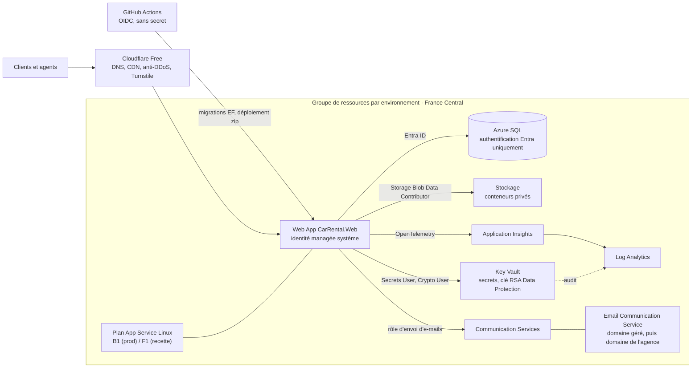

# Infrastructure Azure (Bicep)

Description de l'infrastructure Azure de la plateforme : un groupe de ressources par environnement (**recette** et **prod**), en **France Central**, décrit en Bicep et recréable à l'identique. Les décisions viennent de la [spécification](../docs/SPEC.md) (sections 12 et 14), du [prompt](../docs/PROMPT.md) (section 14) et de l'[ADR-0004](../docs/adr/0004-hebergement-app-service-b1-cloudflare.md).

> **Statut.** Les fichiers sont validés localement (`az bicep build`, `az bicep lint`, `az bicep build-params`) et en CI. Le déploiement réel attend un abonnement Azure et les identifiants OIDC dans GitHub ([points ouverts](../docs/points-ouverts.md), écart n° 7) : ce document décrit la procédure à suivre ce jour-là.

## Sommaire

1. [Contenu du dossier](#1-contenu-du-dossier)
2. [Architecture](#2-architecture)
3. [Sécurité et compromis](#3-sécurité-et-compromis)
4. [Coûts estimés](#4-coûts-estimés)
5. [Premier déploiement pas à pas](#5-premier-déploiement-pas-à-pas)
6. [Intégration et déploiement continus](#6-intégration-et-déploiement-continus)
7. [E-mail : domaine géré puis domaine de l'agence](#7-e-mail--domaine-géré-puis-domaine-de-lagence)
8. [Cloudflare devant l'App Service](#8-cloudflare-devant-lapp-service)
9. [Passer la base de Basic à S0](#9-passer-la-base-de-basic-à-s0)
10. [Rotation des secrets et des clés](#10-rotation-des-secrets-et-des-clés)
11. [Restauration](#11-restauration)
12. [Supprimer et recréer la recette](#12-supprimer-et-recréer-la-recette)
13. [Dépannage](#13-dépannage)
14. [Durcissement ultérieur](#14-durcissement-ultérieur)
15. [Alertes](#15-alertes)
16. [Sauvegardes, rétention et immuabilité](#16-sauvegardes-rétention-et-immuabilité)

## 1. Contenu du dossier

| Fichier | Rôle |
|---|---|
| `main.bicep` | Point d'entrée (portée : groupe de ressources), paramètres, noms, paramètres applicatifs, sorties |
| `modules/monitoring.bicep` | Log Analytics et Application Insights (basé sur l'espace de travail), plafonds journaliers |
| `modules/storage.bicep` | Compte de stockage, suppression réversible, versions, restauration à un instant, conteneurs privés, cycle de vie |
| `modules/keyvault.bicep` | Key Vault (RBAC), clé RSA de Data Protection avec rotation, journaux d'audit |
| `modules/sql.bicep` | Serveur Azure SQL (Entra uniquement), pare-feu, base, sauvegardes courte et longue durée |
| `modules/communication.bicep` | Azure Communication Services, Email Communication Service, domaine géré, domaine personnalisé optionnel |
| `modules/appservice.bicep` | Plan Linux, Web App, journaux, authentification de base désactivée |
| `modules/rbac.bicep` | Rôles de l'identité managée de la Web App et du groupe d'administration, rôle personnalisé d'envoi d'e-mails |
| `modules/budget.bicep` | Budget mensuel optionnel avec alertes |
| `modules/alerts.bicep` | Groupe d'actions (e-mails, SMS facultatifs) et règles d'alerte à faible coût : métriques de la plateforme et télémétrie de l'application ([section 15](#15-alertes), [ADR-0060](../docs/adr/0060-alertes-et-telemetrie-de-sante.md)) |
| `main.prod.bicepparam`, `main.recette.bicepparam` | Paramètres par environnement (identifiants du tenant lus dans des variables d'environnement) |
| `sql/create-database-users.sql` | T-SQL à exécuter une fois : utilisateurs de base des identités Entra |
| `bicepconfig.json` | Règles du linter Bicep (les règles de sécurité sont en erreur) |

Validation locale, sans connexion à Azure :

```bash
az bicep build --file infra/main.bicep --stdout > /dev/null
az bicep lint --file infra/main.bicep
SQL_ADMIN_GROUP_OBJECT_ID=00000000-0000-0000-0000-000000000000 SQL_ADMIN_GROUP_NAME=x \
  az bicep build-params --file infra/main.prod.bicepparam --stdout > /dev/null
```

## 2. Architecture



### Ressources

| Ressource | Production | Recette | Points clés |
|---|---|---|---|
| Plan App Service (Linux) | B1 | F1 (gratuit) | Une instance ; B1 sans emplacement de déploiement, d'où le déploiement nocturne |
| Web App | `DOTNETCORE\|10.0` | idem | Identité managée système, HTTPS seul, TLS 1.2 minimum, FTPS désactivé, HTTP/2, WebSockets, affinité ARR, Always On (sauf F1), contrôle de santé `/health/ready` (sauf F1), authentification de base FTP et SCM désactivée, commande de démarrage `dotnet CarRental.Web.dll` ; avec `restrictToCloudflare`, site principal réservé aux plages IP de Cloudflare ([section 8](#8-cloudflare-devant-lapp-service)) |
| Serveur Azure SQL | Entra uniquement | idem | Administrateur = groupe Entra (paramètre), TLS 1.2, règle « Autoriser les services Azure » |
| Base Azure SQL | Basic (5 DTU, 2 Go) | Offre gratuite (serverless, 32 Go) | Restauration à un instant 7 jours ; rétention longue hebdomadaire (5 semaines), mensuelle (12 mois) et **annuelle (10 ans)** en prod ; sauvegardes géo-redondantes en prod, locales en recette ([section 16](#16-sauvegardes-rétention-et-immuabilité)) |
| Stockage | StorageV2, GRS | StorageV2, LRS | Aucun accès public, accès par clé partagée désactivé, TLS 1.2, versions, suppression réversible des blobs et des conteneurs (30 j prod, 7 j recette), suppression des anciennes versions après 90 j (30 j recette) ; en prod, conteneur `invoices` **immuable 10 ans** (rétention temporelle non verrouillée), donc sans restauration à un instant (incompatible avec l'immuabilité) |
| Key Vault | standard, RBAC | idem | Suppression réversible (90 j prod, 7 j recette), protection contre la purge (prod), clé RSA 3072 `dataprotection` tournée chaque année, journaux d'audit vers Log Analytics |
| Log Analytics + Application Insights | plafond 0,15 Go/jour | 0,1 Go/jour | Rétention 30 jours ; le plafond de l'espace de travail s'applique aussi aux données d'Application Insights (ingestion arrêtée jusqu'à la remise à zéro quotidienne) |
| Communication Services + Email | domaine géré Azure | idem | Données au repos en France (`dataLocation`), suivi des ouvertures désactivé |
| Budget | 40 (devise de facturation) | 10 | Alertes à 80 % du réel et 100 % de la prévision, seulement si `BUDGET_ALERT_EMAIL` est défini |
| Alertes | groupe d'actions + 8 règles | 4 règles | Seulement si `ALERT_EMAILS` est défini ([section 15](#15-alertes)) ; test de disponibilité facultatif (`availabilityTestUrl`) |

Conteneurs privés : `documents` (pièces d'identité et permis), `inspections` (photos d'états des lieux), `contracts` (PDF), `invoices` (factures et avoirs, PDF et XML TEIF), `exports`, `fleet` (photos des catégories, servies sans authentification par l'application, et des véhicules), `dataprotection` (trousseau de clés ASP.NET Core).

### Noms

Les noms dérivent de `baseName` (`carrental`) et de l'environnement ; un suffixe de 6 caractères (`uniqueString` du groupe de ressources) garantit l'unicité mondiale là où elle est exigée. Il est stable : redéployer dans le même groupe de ressources redonne les mêmes noms.

| Ressource | Modèle | Exemple (prod) |
|---|---|---|
| Plan App Service | `asp-<base>-<env>` | `asp-carrental-prod` |
| Web App | `app-<base>-<env>-<suffixe>` | `app-carrental-prod-a1b2c3` |
| Serveur SQL / base | `sql-<base>-<env>-<suffixe>` / `<base>` | `sql-carrental-prod-a1b2c3` / `carrental` |
| Stockage | `st<base><prd\|rec><suffixe>` | `stcarrentalprda1b2c3` |
| Key Vault | `kv-<base>-<prd\|rec>-<suffixe>` | `kv-carrental-prd-a1b2c3` |
| Log Analytics / Application Insights | `log-<base>-<env>` / `appi-<base>-<env>` | `log-carrental-prod` |
| Email / Communication Services | `ecs-<base>-<env>-<suffixe>` / `acs-<base>-<env>-<suffixe>` | `acs-carrental-prod-a1b2c3` |

### Paramètres de l'application (App Service)

Le contrat de configuration avec l'application ; aucun secret n'y figure.

| Paramètre | Valeur |
|---|---|
| `ASPNETCORE_ENVIRONMENT` | `Production` (prod), `Staging` (recette) |
| `ConnectionStrings__Sql` | `Server=tcp:<serveur>.database.windows.net,1433;Database=carrental;Authentication=Active Directory Default;Encrypt=True;` |
| `Storage__BlobServiceUri` | `https://<stockage>.blob.core.windows.net/` |
| `DataProtection__BlobUri` | `https://<stockage>.blob.core.windows.net/dataprotection/keys.xml` |
| `DataProtection__KeyVaultKeyUri` | `https://<coffre>.vault.azure.net/keys/dataprotection` (sans version : la version courante sert à chiffrer, les anciennes restent utilisables pour déchiffrer) |
| `KeyVault__Uri` | `https://<coffre>.vault.azure.net/` |
| `APPLICATIONINSIGHTS_CONNECTION_STRING` | lue sur la ressource Application Insights (jamais en sortie de déploiement) |
| `Email__AcsEndpoint` | `https://<acs>.<zone>.communication.azure.com` (nom d'hôte de la ressource Communication Services) |
| `Email__SenderAddress` | `DoNotReply@<guid>.azurecomm.net`, puis `noreply@<domaine de l'agence>` |
| `Seed__Demo` | `true` en recette, `false` en prod |
| `Identity__InitialSupportEmail` | paramètre `initialSupportEmail` : si aucun compte support n'existe, ce compte (l'exploitant de la plateforme, [ADR-0067](../docs/adr/0067-plateforme-multi-agences-cloisonnement-support-modules.md)) est créé au démarrage sans mot de passe ; il le définit par « mot de passe oublié », enrôle sa double authentification, puis crée les agences et invite leurs gérants |
| `HostFiltering__CustomDomains` | paramètre `customDomains` (`www.agence.tn;agence.tn`) : l'application n'accepte que `*.azurewebsites.net`, `localhost` et ces domaines (réponse 400 sinon, sauf `/health*`) |
| `ReverseProxy__TrustCloudflareHeader` | `true` seulement avec `restrictToCloudflare` : l'adresse du client (limitation de débit, journal d'audit) est alors lue dans `CF-Connecting-IP`, qu'aucun client ne peut plus forger ; `false` sinon, adresse de connexion ([section 8](#8-cloudflare-devant-lapp-service)) |
| `PublicSite__BaseUrl` | paramètre `publicSiteBaseUrl`, par défaut `https://<webApp>.azurewebsites.net` (liens absolus des e-mails, sitemap, liens profonds) |
| `PublicSite__AgencyName`, `PublicSite__WhatsAppNumber` | paramètres `publicSiteAgencyName` et `publicSiteWhatsAppNumber` (bouton WhatsApp masqué si vide) |
| `WhatsApp__Mode`, `WhatsApp__PhoneNumberId`, `WhatsApp__BusinessAccountId` | `Graph` une fois le numéro WhatsApp Business validé (sinon le canal reste désactivé) ; identifiants lus dans le gestionnaire WhatsApp de Meta ; webhook à déclarer chez Meta sur `https://<domaine>/webhooks/whatsapp` avec le jeton `WhatsApp--VerifyToken` |
| `Ai__Mode`, `Ai__Model`, `Ai__PilotNumbers` | `Anthropic` (ou `Foundry` avec `Ai__Foundry__Resource`) une fois la clé de l'agence dans le Key Vault (`Ai--ApiKey`) ; sans réglage, le bot reste désactivé hors développement ; numéros pilotes séparés par `;` pour une ouverture progressive |
| `BotTurns__MaxParallelism` (facultatif) | 4 par défaut (une connexion SQL par tour en cours) |
| `ASPNETCORE_FORWARDEDHEADERS_ENABLED` | `true` : l'application lit `X-Forwarded-Proto` et `X-Forwarded-For` posés par le frontal App Service |
| `SCM_DO_BUILD_DURING_DEPLOYMENT` | `false` : le paquet publié est déployé tel quel |

Les secrets (Clic to Pay, WhatsApp, Anthropic, Turnstile…) vont dans le Key Vault, lus par le fournisseur de configuration Key Vault de l'application (`KeyVault__Uri`) ; une référence `@Microsoft.KeyVault(VaultName=<coffre>;SecretName=<nom>)` dans un paramètre d'application fonctionne aussi.

### Rôles (RBAC)

| Principal | Rôle | Portée | Usage |
|---|---|---|---|
| Identité managée de la Web App | Storage Blob Data Contributor | compte de stockage | Blobs, trousseau Data Protection, clé de délégation pour les liens SAS de 5 minutes |
| Identité managée de la Web App | Key Vault Secrets User | Key Vault | Lecture des secrets |
| Identité managée de la Web App | Key Vault Crypto User | Key Vault | Chiffrement et déchiffrement des clés Data Protection (`wrapKey`, `unwrapKey`) |
| Identité managée de la Web App | CarRental ACS Email Sender (rôle personnalisé) | Communication Services | Envoi d'e-mails avec un jeton Entra ; évite Contributor, qui permettrait aussi de lire les clés d'accès ou de supprimer la ressource |
| Groupe « CarRental SQL Admins » | Key Vault Secrets Officer | Key Vault | Gestion des secrets applicatifs (paramètre `grantAdminGroupKeyVaultSecretsOfficer`) |
| Identité managée de la Web App | `db_datareader`, `db_datawriter`, `db_ddladmin`, `EXECUTE` | base (T-SQL) | Application ; `db_ddladmin` pour le schéma Hangfire créé au démarrage |
| Identité GitHub de déploiement | Website Contributor, SQL Server Contributor | groupe de ressources | Déploiement zip, règle de pare-feu temporaire |
| Identité GitHub de déploiement | `db_owner` | base (T-SQL) | Bundle de migrations EF Core |

## 3. Sécurité et compromis

- **Aucun mot de passe.** Azure SQL n'accepte que l'authentification Microsoft Entra ; le stockage refuse les clés de compte ; GitHub se connecte à Azure par OIDC (identifiants fédérés). Les seules valeurs sensibles restantes sont les secrets des partenaires, dans le Key Vault.
- **« Autoriser les services Azure » sur Azure SQL.** Nécessaire pour qu'une Web App sans intégration réseau joigne la base. La règle ouvre le point de terminaison à toutes les adresses Azure, tous clients confondus ; l'authentification Entra uniquement et des rôles stricts en limitent la portée. L'alternative (intégration au réseau virtuel + point de terminaison privé, environ 8 USD par mois et par point de terminaison) n'est pas justifiée à ce stade.
- **Accès par clé partagée désactivé sur le stockage.** Avantages : aucune clé de compte à protéger ni à faire tourner, chaque accès est authentifié par Entra et autorisé par RBAC. Conséquences :
  - les liens de téléchargement de 5 minutes sont des **SAS de délégation d'utilisateur** : l'application obtient une clé de délégation (`BlobServiceClient.GetUserDelegationKeyAsync`, valable 7 jours au plus, à mettre en cache) puis signe le SAS avec `BlobSasBuilder` ; un SAS de compte ou de service signé par clé est impossible ;
  - les outils doivent utiliser Entra : `az storage … --auth-mode login`, Azure Storage Explorer connecté avec un compte, portail en mode « compte Microsoft Entra » (activé par défaut ici) ; il faut alors un rôle de données sur le compte, à n'attribuer qu'au besoin et temporairement, car il donne accès aux pièces d'identité hors du journal d'accès de l'application ;
  - les fonctions Azure qui exigent une clé (sauvegarde App Service vers un stockage, `AzureWebJobsStorage` d'Azure Functions) ne sont pas utilisables avec ce compte ; aucune n'est prévue ;
  - en local, Azurite garde sa clé de développement publique : rien ne change pour les tests.
- **Key Vault en mode RBAC**, suppression réversible, protection contre la purge en prod (irréversible ; absente en recette pour pouvoir recréer l'environnement), journaux d'audit dans Log Analytics. Le point de terminaison reste public (pas de point de terminaison privé à ce budget) ; seuls les principaux Entra autorisés y accèdent.
- **App Service** : authentification de base FTP et SCM désactivée (le déploiement zip utilise un jeton Entra), FTPS désactivé, TLS 1.2, HTTPS seul. Les en-têtes de sécurité (HSTS, CSP…) restent du ressort de l'application.
- **Origine réservée à Cloudflare** (paramètre `restrictToCloudflare`, désactivé par défaut, [ADR-0062](../docs/adr/0062-origine-cloudflare-et-revue-de-securite.md)) : tant qu'il est désactivé, n'importe qui peut joindre `*.azurewebsites.net` ; l'application ne croit donc pas l'en-tête `CF-Connecting-IP` (`ReverseProxy__TrustCloudflareHeader=false`) et compte chaque client par son adresse de connexion. Une fois le domaine derrière Cloudflare, l'activer ferme l'origine à tout le reste et rend l'en-tête fiable ([section 8](#8-cloudflare-devant-lapp-service)).
- **Application Insights** accepte la chaîne de connexion (authentification locale) : c'est ce que reçoit l'application. Passer à l'ingestion Entra uniquement est un durcissement possible ([section 14](#14-durcissement-ultérieur)).
- **Données hors de Tunisie.** Toutes les ressources régionales sont en France Central ; les sauvegardes géo-redondantes et le stockage GRS répliquent en France South ; Communication Services stocke ses données en France. L'autorisation de l'INPDP doit couvrir ce transfert avant la production ([ADR-0010](../docs/adr/0010-conformite-ttn-inpdp.md)).

## 4. Coûts estimés

Ordres de grandeur en USD par mois, hors usage variable, à vérifier dans la [calculatrice Azure](https://azure.microsoft.com/pricing/calculator/) pour France Central (point ouvert « Coûts Azure »). Cible de la spécification (section 12) : 20 à 35 USD par mois.

| Poste | Production | Recette |
|---|---|---|
| App Service Linux | B1 ≈ 13 | F1 : 0 |
| Azure SQL | Basic ≈ 5 (S0 ≈ 15) | Offre gratuite : 0 |
| Sauvegardes SQL (rétention longue, géo-redondance) | < 0,5 la première année, < 1 au bout de 10 ans (une sauvegarde annuelle de plus chaque année) | 0 |
| Stockage (GRS, versions) | ≈ 0,5 à 1,5 | < 0,2 |
| Key Vault (opérations, rotation annuelle à environ 1 USD) | < 0,2 | < 0,1 |
| Log Analytics + Application Insights | 0 dans les 5 Go gratuits par mois et par compte de facturation ; pire cas plafonné à environ 8 USD pour les deux environnements | 0 |
| Alertes ([section 15](#15-alertes)) | ≈ 2 à 3 : 4 règles de recherche dans les journaux toutes les 15 minutes (fréquence la moins chère) et leurs séries de dimension, 4 alertes de métriques (dans les 10 séries gratuites), e-mails gratuits jusqu'à 1 000 par mois ; SMS facturés dès le premier hors des États-Unis | 0 (aucune règle sans `ALERT_EMAILS`) |
| Test de disponibilité standard (facultatif) | ≈ 3 à 4 par emplacement (une exécution toutes les 15 minutes, facturée à l'exécution) ; 0 avec une surveillance externe gratuite | 0 |
| E-mail (ACS) | ≈ 0,25 USD pour 1 000 e-mails | ≈ 0 |
| Budget, Cloudflare Free | 0 | 0 |
| **Total** | **≈ 21 à 24** (Basic), **≈ 31 à 34** (S0), sans test de disponibilité | **≈ 0 à 1** |

S'y ajoutent les coûts variables de la spécification : WhatsApp au-delà du quota gratuit, IA, commissions Clic to Pay et Booking.com. Le budget Azure (paramètre `budgetAmount`) alerte en cas de dérive.

## 5. Premier déploiement pas à pas

Les commandes sont écrites pour bash (Git Bash sous Windows) ; sous PowerShell, remplacer `export NOM=valeur` par `$env:NOM = "valeur"`. Elles supposent Azure CLI 2.60 ou plus récent et un compte **Propriétaire** de l'abonnement : le déploiement de l'infrastructure crée des attributions de rôles et un rôle personnalisé, c'est pourquoi il est fait à la main et non par GitHub Actions, dont l'identité garde des droits réduits.

### 5.1 Préparer l'abonnement

```bash
az login
az account set --subscription "<id ou nom de l'abonnement>"

# Fournisseurs de ressources (une fois par abonnement)
for ns in Microsoft.Web Microsoft.Sql Microsoft.Storage Microsoft.KeyVault Microsoft.OperationalInsights \
          Microsoft.Insights Microsoft.Communication Microsoft.Consumption; do
  az provider register --namespace "$ns"
done

# Un groupe de ressources par environnement
az group create --name rg-carrental-recette --location francecentral --tags application=car-rental environment=recette
az group create --name rg-carrental-prod --location francecentral --tags application=car-rental environment=prod
```

Ne pas poser de verrou « CanNotDelete » sur le groupe de ressources ni sur le serveur SQL : il empêcherait le flux de déploiement de supprimer sa règle de pare-feu temporaire. Un verrou sur la base de production et sur le compte de stockage est en revanche recommandé une fois la production ouverte :

```bash
az lock create --name no-delete --lock-type CanNotDelete \
  --resource "$(az sql db show --resource-group rg-carrental-prod --server <sqlServerName> --name carrental --query id -o tsv)"
az lock create --name no-delete --lock-type CanNotDelete \
  --resource "$(az storage account show --resource-group rg-carrental-prod --name <storageAccountName> --query id -o tsv)"
```

Retirer temporairement le verrou de la base avant un échange de bases lors d'une restauration ([section 11](#11-restauration)).

### 5.2 Créer le groupe Entra d'administration SQL

```bash
az ad group create --display-name "CarRental SQL Admins" --mail-nickname carrental-sql-admins
az ad group member add --group "CarRental SQL Admins" --member-id "$(az ad signed-in-user show --query id -o tsv)"
```

Ses membres administrent les serveurs SQL des deux environnements et, par défaut, gèrent les secrets du Key Vault.

### 5.3 Déployer l'infrastructure de recette

```bash
export SQL_ADMIN_GROUP_OBJECT_ID="$(az ad group show --group "CarRental SQL Admins" --query id -o tsv)"
export SQL_ADMIN_GROUP_NAME="CarRental SQL Admins"
export BUDGET_ALERT_EMAIL="<adresse qui reçoit les alertes de budget>"   # facultatif
export ALERT_EMAILS="<adresse>;<autre adresse>"                         # facultatif : règles d'alerte (section 15)

az deployment group what-if --resource-group rg-carrental-recette --parameters infra/main.recette.bicepparam
az deployment group create --resource-group rg-carrental-recette --name main \
  --parameters infra/main.recette.bicepparam

# Sorties : noms à reporter dans le script SQL (étape 5.5) et dans GitHub (étape 5.6)
az deployment group show --resource-group rg-carrental-recette --name main --query properties.outputs -o json
```

Le premier déploiement prend une dizaine de minutes. Sorties utiles : `webAppName`, `webAppHostName`, `sqlServerName`, `sqlServerFqdn`, `sqlDatabaseName`, `storageBlobEndpoint`, `keyVaultName`, `keyVaultUri`, `emailSenderAddress`, `customDomainVerificationId`.

### 5.4 Créer l'identité GitHub de déploiement (OIDC)

Une inscription d'application par environnement : l'identité de recette ne peut rien sur la production.

```bash
REPO="omarRamo/rental-car-agencies"
for ENV in recette prod; do
  APP_ID="$(az ad app create --display-name "github-carrental-deploy-$ENV" --query appId -o tsv)"
  SP_ID="$(az ad sp create --id "$APP_ID" --query id -o tsv)"
  az ad app federated-credential create --id "$APP_ID" --parameters "{
    \"name\": \"github-environment-$ENV\",
    \"issuer\": \"https://token.actions.githubusercontent.com\",
    \"subject\": \"repo:$REPO:environment:$ENV\",
    \"audiences\": [\"api://AzureADTokenExchange\"]
  }"
  RG_ID="$(az group show --name "rg-carrental-$ENV" --query id -o tsv)"
  for ROLE in "Website Contributor" "SQL Server Contributor"; do
    az role assignment create --assignee-object-id "$SP_ID" --assignee-principal-type ServicePrincipal \
      --role "$ROLE" --scope "$RG_ID" --output none
  done
  echo "$ENV : AZURE_CLIENT_ID=$APP_ID"
done
```

Le sujet du jeton GitHub vaut `repo:omarRamo/rental-car-agencies:environment:<recette|prod>` parce que le travail de déploiement déclare son environnement GitHub. La comparaison respecte la casse : le propriétaire et le dépôt doivent s'écrire exactement comme sur GitHub (en cas de doute, lire la ligne « subject claim » des « Federated token details » dans le journal de l'étape de connexion). Aucun secret client n'est créé.

### 5.5 Créer les utilisateurs de base de données

Une fois par environnement, en tant que membre du groupe « CarRental SQL Admins », connecté à la base `carrental` (pas à `master`). Avec [go-sqlcmd](https://aka.ms/go-sqlcmd) (`winget install sqlcmd`) :

```bash
sqlcmd -S "<sqlServerFqdn>" -d carrental --authentication-method ActiveDirectoryAzCli \
  -i infra/sql/create-database-users.sql \
  -v WebAppName="<webAppName>" -v DeployPrincipalName="github-carrental-deploy-recette"
```

Ou dans le portail (base SQL > Éditeur de requête, authentification Entra), en remplaçant `$(WebAppName)` et `$(DeployPrincipalName)` à la main. Le script, idempotent, crée :

- l'utilisateur de l'identité managée de la Web App (son nom est celui de la Web App) : lecture, écriture, `EXECUTE`, et `db_ddladmin` tant que Hangfire crée son schéma au démarrage ;
- l'utilisateur de l'identité GitHub de déploiement : `db_owner`, pour le bundle de migrations.

Si la Web App ou l'inscription d'application est recréée, son identité change : supprimer l'utilisateur (`DROP USER [nom]`) et relancer le script.

### 5.6 Configurer GitHub

| Nom | Type | Portée | Valeur |
|---|---|---|---|
| `AZURE_DEPLOY_ENABLED` | variable | dépôt | `true` (tant qu'elle est absente, le flux de déploiement est ignoré, sans échec) |
| `AZURE_CLIENT_ID` | secret | environnement `recette` / `prod` | `appId` de l'inscription `github-carrental-deploy-<env>` |
| `AZURE_TENANT_ID` | secret | environnement | `az account show --query tenantId -o tsv` |
| `AZURE_SUBSCRIPTION_ID` | secret | environnement | `az account show --query id -o tsv` |
| `AZURE_RESOURCE_GROUP` | variable | environnement | `rg-carrental-<env>` |
| `AZURE_WEBAPP_NAME` | variable | environnement | sortie `webAppName` |
| `AZURE_SQL_SERVER` | variable | environnement | sortie `sqlServerName` (nom court, sans `.database.windows.net`) |
| `AZURE_SQL_DATABASE` | variable | environnement | sortie `sqlDatabaseName` (`carrental`) |
| `HEALTHCHECK_BASE_URL` | variable (facultative) | environnement | URL publique (par exemple `https://www.<domaine>`) une fois l'App Service réservé à Cloudflare ([section 8](#8-cloudflare-devant-lapp-service)) |

Avec GitHub CLI :

```bash
REPO="omarRamo/rental-car-agencies"
gh api --method PUT "repos/$REPO/environments/recette" --silent
gh api --method PUT "repos/$REPO/environments/prod" --silent \
  -F "deployment_branch_policy[protected_branches]=false" -F "deployment_branch_policy[custom_branch_policies]=true"
gh api --method POST "repos/$REPO/environments/prod/deployment-branch-policies" -f name=main -f type=branch --silent

ENV=recette   # puis ENV=prod
gh secret set AZURE_CLIENT_ID --env "$ENV" --body "<appId>"
gh secret set AZURE_TENANT_ID --env "$ENV" --body "$(az account show --query tenantId -o tsv)"
gh secret set AZURE_SUBSCRIPTION_ID --env "$ENV" --body "$(az account show --query id -o tsv)"
gh variable set AZURE_RESOURCE_GROUP --env "$ENV" --body "rg-carrental-$ENV"
gh variable set AZURE_WEBAPP_NAME --env "$ENV" --body "<webAppName>"
gh variable set AZURE_SQL_SERVER --env "$ENV" --body "<sqlServerName>"
gh variable set AZURE_SQL_DATABASE --env "$ENV" --body "carrental"

gh variable set AZURE_DEPLOY_ENABLED --body true
```

L'environnement `prod` n'accepte que la branche `main`. Ne pas lui ajouter de relecteur obligatoire si le déploiement nocturne doit rester automatique : chaque nuit attendrait sinon une approbation.

### 5.7 Renseigner les secrets applicatifs

Les membres du groupe d'administration ont le rôle Key Vault Secrets Officer. Le fournisseur de configuration Key Vault traduit `--` en `:` ; les noms ci-dessous sont des exemples, à aligner sur les options typées de l'application :

```bash
az keyvault secret set --vault-name "<keyVaultName>" --name "ClicToPay--Password" --file ./clictopay-password.txt
az keyvault secret set --vault-name "<keyVaultName>" --name "WhatsApp--AccessToken" --file ./whatsapp-access-token.txt
az keyvault secret set --vault-name "<keyVaultName>" --name "WhatsApp--AppSecret" --file ./whatsapp-app-secret.txt
az keyvault secret set --vault-name "<keyVaultName>" --name "WhatsApp--VerifyToken" --file ./whatsapp-verify-token.txt
az keyvault secret set --vault-name "<keyVaultName>" --name "Ai--ApiKey" --file ./claude-api-key.txt
# Facultatif (Foundry) : sans clé, l'identité managée de la Web App doit avoir accès aux modèles de la ressource
az keyvault secret set --vault-name "<keyVaultName>" --name "Ai--Foundry--ApiKey" --file ./foundry-api-key.txt
az keyvault secret set --vault-name "<keyVaultName>" --name "Turnstile--SecretKey" --file ./turnstile-secret.txt
# Clé de signature des jetons de l'API des applications clientes (ADR-0070) : 32 octets aléatoires au moins, obligatoire hors développement
openssl rand -base64 48 > ./customer-api-signing-key.txt
az keyvault secret set --vault-name "<keyVaultName>" --name "CustomerApi--Jwt--SigningKey" --file ./customer-api-signing-key.txt
```

`--file` évite de laisser le secret dans l'historique du terminal ; supprimer le fichier ensuite.

**Recette : comptes de démonstration.** Avec `Seed__Demo=true`, les trois comptes de démonstration (gérant, agent, comptable) ne sont créés que si ces deux secrets existent ; sinon ils sont ignorés avec un avertissement dans les journaux :

```bash
az keyvault secret set --vault-name "<keyVaultName>" --name "Seed--DemoUserPassword" --file ./demo-password.txt
# Clé TOTP partagée des comptes de démonstration : Base32, au moins 16 caractères
az keyvault secret set --vault-name "<keyVaultName>" --name "Seed--DemoAuthenticatorKey" --file ./demo-totp-key.txt
```

**Production : premier compte support.** Ne pas activer `Seed__Demo`. Renseigner `initialSupportEmail` au déploiement Bicep : au premier démarrage sans compte support, ce compte est créé sans mot de passe ; utiliser « mot de passe oublié » sur `/account/forgot-password`, puis enrôler l'application d'authentification (la double authentification est obligatoire pour accéder à `/admin`). Le support crée ensuite chaque agence depuis `/admin/platform` (adresse de sa vitrine, modules, premier gérant invité par e-mail).

### 5.8 Premier déploiement de l'application

GitHub > Actions > **Deploy** > Run workflow > `recette`. Le flux publie l'application, construit le bundle de migrations, applique les migrations, déploie le paquet zip puis attend que `https://<webAppHostName>/health/ready` réponde 200. La recette charge les données de démonstration au démarrage (`Seed__Demo=true`).

### 5.9 Production

Mêmes étapes avec `rg-carrental-prod`, `infra/main.prod.bicepparam`, l'identité `github-carrental-deploy-prod` et l'environnement GitHub `prod`, en définissant `ALERT_EMAILS` (au moins l'adresse du prestataire informatique) : sans elle, aucune alerte n'est créée. La production n'ouvre au public qu'après l'autorisation de l'INPDP, le contrat Clic to Pay, le domaine de l'agence derrière Cloudflare et l'origine réservée à Cloudflare (sections 7 et 8) ; la liste complète est dans le [runbook](../docs/runbook.md#avant-la-mise-en-production).

## 6. Intégration et déploiement continus

| Flux | Déclencheurs | Contenu |
|---|---|---|
| `.github/workflows/ci.yml` | push et pull request sur `main` | Format (`dotnet format --verify-no-changes`), build `-warnaserror`, tests unitaires et d'architecture, puis en parallèle tests d'intégration (Testcontainers SQL Server et Azurite) et E2E (Playwright, Chromium), couverture fusionnée (ReportGenerator), paquets NuGet vulnérables, analyse de secrets (gitleaks), validation Bicep ; budget Lighthouse de la vitrine (LCP ≤ 2,5 s en mobile simulé, CLS ≤ 0,1, TBT ≤ 200 ms, accessibilité ≥ 0,95) |
| `.github/workflows/codeql.yml` | push et pull request sur `main`, chaque lundi | CodeQL C# (requêtes `security-extended`) |
| `.github/workflows/deploy.yml` | manuel (`recette` ou `prod`), chaque nuit à 01:00 UTC (02:00 à Tunis) vers la prod | Voir ci-dessous |
| `.github/dependabot.yml` | chaque lundi | Mises à jour groupées NuGet, GitHub Actions, SDK .NET |

Déploiement (`deploy.yml`) :

1. **Décision.** Tout est ignoré tant que `AZURE_DEPLOY_ENABLED` n'est pas `true`. La production ne se déploie que depuis `main` et seulement si la CI est verte sur ce commit ; la nuit, rien n'est fait si l'étiquette `deployed-prod` pointe déjà sur le dernier commit de `main`.
2. **Construction** avant la connexion à Azure (le jeton OIDC de GitHub est de courte durée) : `dotnet publish`, puis `dotnet ef migrations bundle` autonome pour linux-x64.
3. **Connexion OIDC**, jeton Entra pour Azure SQL mis en cache par Azure CLI, **règle de pare-feu temporaire** pour l'adresse du runner, **migrations** (bundle, chaîne `Authentication=Active Directory Default`), suppression de la règle même en cas d'échec.
4. **Déploiement zip** (`azure/webapps-deploy`, jeton Entra : l'authentification de base est désactivée), redémarrage, puis **vérification de `/health/ready`** pendant une dizaine de minutes au plus.
5. **Étiquette** : après un déploiement de production réussi, `deployed-prod` est déplacée sur le commit déployé (seul ce travail a le droit d'écrire dans le dépôt).

Les migrations s'appliquent avant le nouveau code : elles doivent rester compatibles avec la version en cours d'exécution (ajouter puis supprimer en deux temps). Les flux programmés de GitHub peuvent être retardés et sont suspendus après 60 jours sans activité sur un dépôt public.

## 7. E-mail : domaine géré puis domaine de l'agence

Le domaine géré par Azure (`<guid>.azurecomm.net`, expéditeur `DoNotReply`) fonctionne dès le déploiement mais ses limites d'envoi sont très basses (de l'ordre de quelques e-mails par minute et d'une dizaine par heure) : il convient à la recette, pas à la production. Pour le domaine de l'agence, une fois le nom de domaine choisi :

1. Dans `main.prod.bicepparam` : `emailCustomDomain = '<domaine>'` (laisser `emailCustomDomainLinked = false`), puis redéployer. Le domaine est créé, non vérifié, avec l'expéditeur `noreply`.
2. Lire les enregistrements à créer :
   ```bash
   az extension add --name communication
   az communication email domain show --resource-group rg-carrental-prod --email-service-name "<ecs-…>" \
     --domain-name "<domaine>" --query verificationRecords
   ```
3. Les créer chez Cloudflare **sans proxy** (nuage gris) : TXT de vérification, SPF (à fusionner avec un SPF existant : un seul enregistrement `v=spf1` par nom), deux CNAME DKIM. Ajouter un DMARC, par exemple `_dmarc` TXT `v=DMARC1; p=quarantine; rua=mailto:<adresse>`.
4. Lancer la vérification (portail : Email Communication Service > Domaines > Vérifier, ou `az communication email domain initiate-verification … --verification-type Domain`, puis `SPF`, `DKIM`, `DKIM2`).
5. Quand tout est « Verified » : `emailCustomDomainLinked = true`, redéployer. Le domaine est lié à Communication Services et `Email__SenderAddress` devient `noreply@<domaine>` (l'application redémarre).
6. Si nécessaire, demander une hausse des limites d'envoi par une demande de support.

## 8. Cloudflare devant l'App Service

Le plan F1 n'accepte pas de domaine personnalisé : la recette reste sur `*.azurewebsites.net`. Pour la production (B1) :

1. Ajouter le domaine à Cloudflare (offre Free) et remplacer les serveurs de noms chez le registraire.
2. **Domaine personnalisé sur l'App Service.** Créer chez Cloudflare le TXT `asuid.www` = sortie `customDomainVerificationId` (il prouve la propriété, même derrière le proxy), puis `az webapp config hostname add --resource-group rg-carrental-prod --webapp-name <webAppName> --hostname www.<domaine>`, et enfin le CNAME `www` → `<webAppHostName>`, **avec proxy** (nuage orange). Le domaine nu redirige vers `www` par une règle de redirection Cloudflare.
3. **Certificat d'origine.** Le certificat géré gratuit d'App Service se renouvelle mal derrière le proxy ; utiliser un certificat d'origine Cloudflare (SSL/TLS > Origin Server, valable 15 ans, reconnu par Cloudflare seulement) :
   ```bash
   openssl pkcs12 -export -out origin.pfx -inkey origin-key.pem -in origin-cert.pem
   az webapp config ssl upload --resource-group rg-carrental-prod --name <webAppName> \
     --certificate-file origin.pfx --certificate-password "<mot de passe du PFX>"
   az webapp config ssl bind --resource-group rg-carrental-prod --name <webAppName> \
     --certificate-thumbprint <empreinte> --ssl-type SNI
   ```
4. **Réglages Cloudflare** : SSL/TLS « Full (strict) », « Always Use HTTPS », TLS 1.2 minimum ; WebSockets activés (indispensables au back office Blazor sur `/_blazor`) ; Rocket Loader et Email Address Obfuscation désactivés (ils réécrivent le HTML et les scripts) ; aucune règle « Cache Everything » (seuls les fichiers statiques sont mis en cache par défaut ; le HTML, `/admin`, `/api`, `/webhooks`, `/payments` et `/health` ne doivent pas l'être) ; Turnstile, dont la clé secrète va dans le Key Vault.
5. **Adresse du client** : derrière Cloudflare, l'adresse réelle du client est dans l'en-tête `CF-Connecting-IP` (journal d'audit, limitation de débit). L'application ne le lit que si `ReverseProxy__TrustCloudflareHeader` vaut `true`, ce que fait l'étape suivante : tant que l'origine accepte tout le monde, n'importe quel client pourrait choisir cet en-tête, donc son adresse.
6. **Réserver l'App Service à Cloudflare** (paramètre Bicep `restrictToCloudflare`, [ADR-0062](../docs/adr/0062-origine-cloudflare-et-revue-de-securite.md)), une fois `https://www.<domaine>` servi par Cloudflare :
   - dans GitHub, environnement `prod` : variable `HEALTHCHECK_BASE_URL` = `https://www.<domaine>` (sinon la vérification après déploiement, faite sur `*.azurewebsites.net`, recevrait un 403) ;
   - dans `main.prod.bicepparam` : `restrictToCloudflare = true`, puis redéployer l'infrastructure (étape 5.3). Le site principal n'accepte plus que les plages de `cloudflareIpRanges` (une règle d'autorisation par plage, refus implicite de tout le reste, réponse 403) et `ReverseProxy__TrustCloudflareHeader` passe à `true` (l'application redémarre) ;
   - le site SCM garde ses propres règles, ouvertes (`scmIpSecurityRestrictionsUseMain = false`) : le déploiement zip depuis GitHub, authentifié par Entra, continue de fonctionner ; le contrôle de santé d'App Service est interne à la plateforme et n'est pas soumis aux restrictions ;
   - vérifier : `curl -sI https://<webAppHostName>/` répond 403, `curl -sI https://www.<domaine>/<adresse-de-l-agence>/fr` répond 200, `https://www.<domaine>/health/ready` répond 200.

   **Plages de Cloudflare.** Le paramètre `cloudflareIpRanges` reprend les listes publiées sur <https://www.cloudflare.com/ips-v4> et <https://www.cloudflare.com/ips-v6> (aussi `https://api.cloudflare.com/client/v4/ips`), relevées le 21/10/2026 : 15 plages IPv4 et 7 IPv6. Cloudflare annonce ses changements à l'avance ; comparer une fois par trimestre (`curl -s https://www.cloudflare.com/ips-v4; curl -s https://www.cloudflare.com/ips-v6`), mettre à jour le paramètre et redéployer. Une plage manquante se voit par des 403 pour une partie des visiteurs (runbook, « Cloudflare et DNS »).

   **Alternative : « Authenticated Origin Pulls »** (mTLS de Cloudflare vers l'origine). Avec le certificat client partagé de Cloudflare, n'importe quel compte Cloudflare peut le présenter : il faut un certificat propre à la zone (« zone-level », disponible sur l'offre gratuite), activer les certificats clients sur l'App Service (`clientCertEnabled`, mode facultatif pour garder `/health` au contrôle de santé) et vérifier dans l'application l'empreinte de `X-ARR-ClientCert` à chaque requête. Plus fort que les plages d'adresses (il distingue notre zone de celles des autres clients de Cloudflare), mais du code et une rotation de certificat en plus : non retenu pour l'instant, la restriction par adresses suffit à rendre `CF-Connecting-IP` fiable.

   **Durcissement complémentaire** : une fois le domaine en service, ajouter le paramètre d'application `HostFiltering__AllowedHosts` = `localhost` (il remplace la valeur `*.azurewebsites.net;localhost;127.0.0.1` d'`appsettings.json`) : l'application ne répondra plus qu'aux domaines de `customDomains` (les sondes `/health*` et le préchauffage d'App Service restent exemptés).

## 8 bis. Domaine propre d'une agence

Une agence peut avoir sa vitrine sur son propre domaine (`www.agence-tunis.tn` au lieu de `www.<domaine>/agence-tunis`, [ADR-0069](../docs/adr/0069-domaines-propres-par-agence.md)) : même application, même App Service, aucune instance de plus. Pour chaque domaine d'agence :

1. **DNS de l'agence** (chez son registraire ou dans sa zone Cloudflare) : `CNAME www` → `<webAppHostName>` (ou vers `www.<domaine>` de la plateforme si la zone de la plateforme est chez Cloudflare et que l'on veut passer par son proxy) ; TXT `asuid.www` = sortie `customDomainVerificationId` pour prouver la propriété à App Service. Le domaine nu de l'agence redirige vers `www` (règle du registraire ou de Cloudflare).
2. **Liaison à l'App Service** : `az webapp config hostname add --resource-group rg-carrental-prod --webapp-name <webAppName> --hostname www.agence-tunis.tn`, puis un certificat :
   - domaine en « DNS seulement » (pas de proxy Cloudflare) : certificat géré gratuit d'App Service, `az webapp config ssl create --resource-group rg-carrental-prod --name <webAppName> --hostname www.agence-tunis.tn` puis `az webapp config ssl bind … --ssl-type SNI` ;
   - domaine derrière le proxy Cloudflare de l'agence : certificat d'origine Cloudflare de **sa** zone, importé et lié comme à l'étape 3 de la section 8 ; avec `restrictToCloudflare`, les plages de Cloudflare sont les mêmes pour toutes les zones.
3. **Turnstile** : ajouter le domaine à la liste des noms du widget (le serveur refuse un défi résolu sur un autre nom d'hôte, ADR-0066).
4. **Dans l'application** : le support ajoute le domaine à la fiche de l'agence (`/admin/platform/agencies/{id}`, « Domaines du site ») ; le premier domaine devient principal, les autres redirigent vers lui. Aucune liste d'hôtes à compléter dans la configuration (`HostFiltering__CustomDomains` reste celle de la plateforme) : l'application accepte les domaines qu'elle connaît.
5. **Vérifier** : `curl -sI https://www.agence-tunis.tn/fr` répond 200 avec `<link rel="canonical" href="https://www.agence-tunis.tn/fr">`, `https://www.agence-tunis.tn/sitemap.xml` ne liste que cette vitrine, `https://www.agence-tunis.tn/admin` renvoie à la connexion du back office de la plateforme.

Le retour de Clic to Pay reste sur l'hôte de la plateforme (une seule boutique) : l'application renvoie ensuite le navigateur sur le domaine de l'agence.

## 9. Passer la base de Basic à S0

Quand le pourcentage de DTU dépasse durablement 80 %, ou quand la base approche 2 Go (taille maximale en Basic) :

1. Dans `main.prod.bicepparam` : `sqlDatabaseSku = 'S0'` (taille maximale portée à 250 Go, incluse dans le prix) et, au besoin, `sqlShortTermRetentionDays = 14` (jusqu'à 35 en Standard).
2. Redéployer la nuit : le changement se fait en ligne, avec une coupure de quelques secondes à la fin.

En dépannage immédiat : `az sql db update --resource-group rg-carrental-prod --server <sqlServerName> --name carrental --service-objective S0 --max-size 250GB`, puis reporter la valeur dans le fichier de paramètres. Revenir en Basic suppose une base de moins de 2 Go et une rétention courte de 7 jours au plus.

## 10. Rotation des secrets et des clés

| Élément | Rotation |
|---|---|
| Clé RSA `dataprotection` (Key Vault) | Automatique chaque année (politique de rotation) ; manuelle : `az keyvault key rotate --vault-name <coffre> --name dataprotection` (rôle Key Vault Crypto Officer, à s'attribuer temporairement). Ne jamais désactiver ni supprimer les anciennes versions : elles déchiffrent les clés Data Protection déjà émises (sinon déconnexion de tous les utilisateurs et perte des jetons « se souvenir de cet appareil ») |
| Clés Data Protection d'ASP.NET Core | Automatique tous les 90 jours par l'application (blob `dataprotection/keys.xml`, protégé par versions et suppression réversible) |
| Secrets applicatifs | Nouvelle version : `az keyvault secret set …` ; puis `az webapp restart --resource-group <rg> --name <webAppName>` si l'application ne les relit qu'au démarrage. Les versions précédentes restent disponibles pour revenir en arrière |
| Identité GitHub | Rien à faire : identifiants fédérés, aucun secret client (en supprimer tout secret créé par erreur) |
| Azure SQL, stockage, Application Insights | Aucun mot de passe ni clé utilisés. Les clés d'accès de Communication Services ne servent pas ; elles peuvent être régénérées sans impact |

## 11. Restauration

Les procédures pas à pas (choix de l'instant, vérifications, échange de bases, communication) sont dans le [runbook](../docs/runbook.md#restaurations) ; les commandes de référence restent ici.

**Azure SQL**

- Restauration à un instant (7 jours) vers une nouvelle base, vérification, puis échange des noms :
  ```bash
  az sql db restore --resource-group rg-carrental-prod --server <sqlServerName> --name carrental \
    --dest-name carrental-restore --time "2026-11-02T08:00:00Z"
  az sql db rename --resource-group rg-carrental-prod --server <sqlServerName> --name carrental --new-name carrental-old
  az sql db rename --resource-group rg-carrental-prod --server <sqlServerName> --name carrental-restore --new-name carrental
  ```
  Redéployer ensuite le Bicep : les politiques de sauvegarde s'appliquent par nom de base. Les utilisateurs Entra sont dans la base restaurée.
- Rétention longue (sauvegardes hebdomadaires 5 semaines, mensuelles 12 mois, annuelles 10 ans : celle de la deuxième semaine de janvier) :
  ```bash
  az sql db ltr-backup list --location francecentral --server <sqlServerName> --database carrental
  az sql db ltr-backup restore --backup-id "<id>" --dest-database carrental-ltr \
    --dest-server <sqlServerName> --dest-resource-group rg-carrental-prod
  ```
- Base supprimée : `az sql db list-deleted …` puis `az sql db restore --deleted-time …`. Région indisponible : restauration géographique de la sauvegarde géo-redondante vers un serveur en France South (`az sql db geo-backup restore`).

**Blobs** (avec un rôle de données attribué temporairement, et `--auth-mode login`)

- Blob supprimé : `az storage blob undelete --account-name <stockage> --container-name documents --name <chemin> --auth-mode login`.
- Version précédente : `az storage blob list … --include v` pour trouver la version, puis `az storage blob copy start` avec `--source-uri "https://<stockage>.blob.core.windows.net/documents/<chemin>?versionid=<version>"` vers le même blob.
- Conteneur supprimé : `az storage container list --account-name <stockage> --include-deleted --auth-mode login`, puis `az storage container restore --account-name <stockage> --name <conteneur> --deleted-version <version> --auth-mode login`.
- Restauration à un instant : **indisponible en production**, incompatible avec le conteneur immuable `invoices` ([section 16](#16-sauvegardes-rétention-et-immuabilité)) ; les versions (90 jours) et la suppression réversible (30 jours) la remplacent, blob par blob (script dans le runbook). Sur un compte sans immuabilité (`blobPointInTimeRestoreDays` > 0) : `az storage blob restore --account-name <stockage> --resource-group <rg> --time-to-restore "2026-11-02T08:00:00Z"` (tout le compte, ou des plages avec `--blob-range`).
- Conteneur `invoices` (prod) : aucun blob de moins de 10 ans ne peut être supprimé ni écrasé, par personne ; il n'y a rien à restaurer, et une suppression ou un écrasement par erreur échoue (409 `BlobImmutableDueToPolicy`).

**Key Vault** : `az keyvault secret list-deleted` puis `az keyvault secret recover`, `az keyvault key recover`, coffre supprimé : `az keyvault recover --name <coffre>`.

**Application** : revenir sur `main` (`git revert` du commit fautif) puis relancer Deploy ; la CI doit être verte. Les migrations ne sont pas annulées automatiquement ; un retour de schéma reste possible avec le bundle (`./efbundle <MigrationPrécédente> --connection …`), avec prudence.

## 12. Supprimer et recréer la recette

```bash
az group delete --name rg-carrental-recette --yes
az keyvault purge --name "<kv-carrental-rec-…>" --location francecentral   # sinon le nom reste réservé 7 jours
```

Un redéploiement dans un groupe de ressources du même nom redonne les mêmes noms. Le rôle personnalisé d'envoi d'e-mails survit à la suppression et sera réutilisé. Recréer ensuite les utilisateurs de base (5.5) et mettre à jour `AZURE_WEBAPP_NAME` et `AZURE_SQL_SERVER` si les noms ont changé.

## 13. Dépannage

| Symptôme | Cause et remède |
|---|---|
| `BCP427: Environment variable "SQL_ADMIN_GROUP_OBJECT_ID" does not exist` | Exporter les variables de l'étape 5.3 avant le déploiement |
| Key Vault : nom déjà utilisé ou coffre supprimé de façon réversible | Recette : `az keyvault purge` ; prod : `az keyvault recover --name <coffre>`, puis redéployer |
| `RoleDefinitionDoesNotExist` ou `PrincipalNotFound` au premier déploiement | Délai de réplication d'Entra ID : relancer le même déploiement |
| Offre gratuite Azure SQL refusée (déjà utilisée dans l'abonnement) | Recette : `sqlDatabaseSku = 'Basic'` (environ 5 USD par mois) |
| `dataLocation` « France » refusée par Communication Services | `communicationDataLocation = 'Europe'` (les deux ressources) et mise à jour du dossier INPDP |
| Recette lente au premier accès, ou erreur 40613 « database not available » | F1 sans Always On et base gratuite en pause automatique : premier accès plus long, nouvelle tentative ; si le quota gratuit mensuel est épuisé, la base reste en pause jusqu'au mois suivant |
| Recette arrêtée : « CPU quota exceeded » | Quota F1 de 60 minutes de processeur par jour : attendre la remise à zéro ou passer temporairement en B1 |
| Déploiement : `AADSTS700213` ou `AADSTS7002138` « No matching federated identity record » | Le sujet de l'identifiant fédéré doit être exactement `repo:omarRamo/rental-car-agencies:environment:<env>`, casse comprise (comparer avec le « subject claim » du journal) |
| Migrations : `Login failed for user '<token-identified principal>'` | Utilisateur de base de l'identité de déploiement absent : étape 5.5 |
| Application : 403 sur le stockage ou le Key Vault juste après le premier déploiement | Propagation des rôles (jusqu'à une dizaine de minutes) : redémarrer la Web App |
| Envoi d'e-mails : 403 | Vérifier le rôle « CarRental ACS Email Sender » ; à défaut, attribuer Contributor sur la seule ressource Communication Services |
| Vérification de santé : 403 | App Service réservé à Cloudflare : renseigner `HEALTHCHECK_BASE_URL` |
| Vérification de santé ou sonde : 429 | Plus de 60 appels par minute de la même adresse sur `/health*` (`RateLimiting:Health`) : une sonde externe trop fréquente, ou une attaque ; attendre une minute |
| Déploiement : la ressource `immutabilityPolicies` du conteneur `invoices` est refusée (politique verrouillée) | La politique a été verrouillée dans le portail : passer `invoiceImmutabilityDays = 0` dans le fichier de paramètres (la politique verrouillée reste en place, le modèle ne la touche plus), garder `blobPointInTimeRestoreDays = 0` et noter la date du verrouillage en commentaire |
| Déploiement : restauration à un instant refusée avec l'immuabilité | Les deux sont incompatibles ; le modèle désactive la restauration à un instant dès qu'un conteneur est immuable : vérifier `blobPointInTimeRestoreDays` et redéployer le module de stockage |
| Alerte `telemetry-missing` alors que le site répond | Plafond journalier de Log Analytics atteint (`logDailyCapGb`) : la télémétrie reprend à la remise à zéro ; voir le runbook, alerte « telemetry-missing » |

## 14. Durcissement ultérieur

Fait au durcissement (passe 1, ADR-0060 à 0062) : alertes ([section 15](#15-alertes)), rétention longue annuelle de 10 ans et factures immuables ([section 16](#16-sauvegardes-rétention-et-immuabilité)), paramètre de réservation de l'origine à Cloudflare ([section 8](#8-cloudflare-devant-lapp-service)). Reste possible :

- Audit Azure SQL vers Log Analytics, limité aux groupes d'actions d'authentification et de modification des droits et du schéma (Hangfire interroge la base en continu : auditer chaque lot ferait exploser le volume) ; Microsoft Defender for SQL (environ 15 USD par mois) et analyse antimalware des blobs (option de la spécification, section 14).
- Ingestion Application Insights par Entra uniquement : `DisableLocalAuth: true`, rôle Monitoring Metrics Publisher pour l'identité managée et `Credential` dans l'exportateur OpenTelemetry.
- Verrouillage des politiques d'immuabilité (factures, sauvegardes longues de la base) une fois la durée de conservation confirmée par l'expert-comptable : irréversible, décision de l'agence ([section 16](#16-sauvegardes-rétention-et-immuabilité)).
- « Authenticated Origin Pulls » avec un certificat propre à la zone, en plus des plages d'adresses ([section 8](#8-cloudflare-devant-lapp-service)).
- Points de terminaison privés et intégration au réseau virtuel, si le budget le permet un jour.

## 15. Alertes

Un groupe d'actions `ag-carrental-<env>` (e-mails de `ALERT_EMAILS`, schéma d'alerte commun ; SMS facultatifs par `alertSmsNumbers`, facturés dès le premier hors des États-Unis) et des règles qui coûtent peu ([ADR-0060](../docs/adr/0060-alertes-et-telemetrie-de-sante.md)) : alertes de métriques de la plateforme et quatre recherches dans les journaux d'Application Insights toutes les 15 minutes. **Rien n'est créé tant que `ALERT_EMAILS` est vide** (recette par défaut). Chaque alerte se résout seule quand la condition disparaît (un second e-mail l'annonce).

L'application publie chaque minute l'état de **chaque entrée de santé** dans la métrique `carrental.health.status` (2 saine, 1 dégradée, 0 en échec, dimension `entry`) : une seule règle couvre toutes les entrées, y compris celles qu'un module ajoutera (par exemple `whatsapp` au lot 4B).

| Règle (`alert-<base>-<env>-…`) | Signal | Seuil, fenêtre | Gravité | Premières actions |
|---|---|---|---|---|
| `site-down` | Métrique App Service `HealthCheckStatus` (contrôle de santé sur `/health/ready`) | moyenne < 100 % sur 15 min, évaluée toutes les 5 min (l'instance est déclarée en échec après 10 sondes ratées) ; pas en F1 | 1 | [runbook](../docs/runbook.md#alerte-site-down) |
| `http-5xx` | Métrique `Http5xx` de la Web App | plus de 10 en 15 min | 2 | [runbook](../docs/runbook.md#alerte-http-5xx) |
| `exceptions` | Table `exceptions` d'Application Insights | plus de 20 en 15 min | 2 | [runbook](../docs/runbook.md#alerte-exceptions) |
| `health-degraded` | `carrental.health.status` par entrée | une entrée jamais saine pendant 15 min (une alerte par entrée) | 2 | [runbook](../docs/runbook.md#alerte-health-degraded), section de l'entrée |
| `payments-gateway` | Compteur `carrental.clictopay.calls`, résultat autre que `Succeeded` (pas de réponse, réponse illisible, requête refusée par la passerelle ; jamais un refus de carte) | au moins 3 en 15 min | 1 | [runbook](../docs/runbook.md#alerte-payments-gateway) |
| `telemetry-missing` | Absence de `carrental.health.status` | aucune mesure pendant 30 min ; pas en F1 (l'application s'y endort) | 2 | [runbook](../docs/runbook.md#alerte-telemetry-missing) |
| `sql-dtu` | Métrique `dtu_consumption_percent` de la base | moyenne > 90 % sur 30 min ; DTU seulement (pas l'offre gratuite) | 3 | [runbook](../docs/runbook.md#alerte-sql-capacity) |
| `sql-storage` | Métrique `storage_percent` de la base | > 80 % de la taille maximale (2 Go en Basic) | 2 | [runbook](../docs/runbook.md#alerte-sql-capacity) |
| `availability` (facultative) | Test de disponibilité standard `GET <availabilityTestUrl>` toutes les 15 min | un emplacement en échec | 1 | [runbook](../docs/runbook.md#alerte-availability) |

Couverture des alertes demandées par la spécification (§14) :

| Demande | Règle |
|---|---|
| Erreurs | `http-5xx`, `exceptions`, `site-down` |
| Paiements en échec | `payments-gateway` (appels en échec technique) et entrée `payments` de `health-degraded` (paiement signalé à vérifier, capture, annulation ou remboursement non confirmé depuis plus d'une heure) |
| Synchronisation de canal en échec | entrée `channels` (envoi en échec définitif, ou plus ancien envoi dû en retard de plus de 30 min) |
| File WhatsApp bloquée | entrée `outbox` (message en échec définitif, ou plus ancien message en attente depuis plus de 30 min : réception, envoi et tours du bot passent par l'outbox) ; entrée `whatsapp` du lot 4B quand elle existera |
| Échéances de flotte | entrée `jobs` : la tâche `fleet.deadline_alerts` (e-mail quotidien des échéances, 07:00 à Tunis) a échoué, n'est plus planifiée ou ne se déclenche plus ; de même pour toutes les tâches récurrentes |
| Messages de fond en échec | entrée `outbox` |

**Disponibilité vue d'Internet.** `site-down` vient de l'intérieur d'App Service ; il ne voit ni le DNS, ni Cloudflare, ni le certificat. Deux options :

- **surveillance externe gratuite** (recommandée à ce budget) : un service de surveillance d'URL à offre gratuite (par exemple UptimeRobot ou Better Stack ; vérifier leurs conditions d'usage commercial) qui interroge `https://www.<domaine>/health` toutes les 5 minutes et prévient par e-mail ; `/health` ne lit pas la base et reste sous la limite de 60 appels par minute et par adresse. Cloudflare n'offre pas de contrôle de santé dans l'offre gratuite ;
- **test standard d'Application Insights** : `availabilityTestUrl = 'https://www.<domaine>/health'` dans `main.prod.bicepparam` (environ 3 à 4 USD par mois et par emplacement, `availabilityTestLocations`), avec l'alerte `availability`.

**Réglages.** Les seuils sont les paramètres du module (`http5xxThreshold`, `exceptionsThreshold`, `paymentFailuresThreshold`, `sqlDtuPercentThreshold`, `sqlStoragePercentThreshold`) : les passer dans l'appel du module `alerts` de `main.bicep`. L'état publié se lit dans Application Insights > Journaux :

```kusto
customMetrics
| where name == "carrental.health.status"
| summarize arg_max(timestamp, value) by entry = tostring(customDimensions["entry"])
```

**Vérifier le groupe d'actions** après le premier déploiement : portail > Monitor > Alertes > Groupes d'actions > `ag-carrental-prod` > « Tester » (un e-mail par destinataire). Une alerte de recherche dépend de l'ingestion : si le plafond journalier de Log Analytics est atteint, les règles de télémétrie se taisent jusqu'à la remise à zéro et `telemetry-missing` se déclenche.

## 16. Sauvegardes, rétention et immuabilité

Décisions et raisons : [ADR-0061](../docs/adr/0061-sauvegardes-retention-et-immuabilite.md) ; restaurations : [runbook](../docs/runbook.md#restaurations).

| Données | Protection en production | Recette |
|---|---|---|
| Base Azure SQL | Restauration à un instant 7 jours (maximum en Basic) ; rétention longue : chaque sauvegarde hebdomadaire 5 semaines, la première de chaque mois 12 mois, **celle de la deuxième semaine de janvier 10 ans** (année close complète) ; sauvegardes géo-redondantes (restauration en France South) ; une base ou un serveur supprimé garde ses sauvegardes longues | 7 jours, locales, pas de rétention longue |
| Blobs (pièces, photos, contrats, factures, exports) | Versions (anciennes versions supprimées après 90 jours), suppression réversible des blobs et des conteneurs 30 jours, stockage GRS ; pas de restauration à un instant (incompatible avec l'immuabilité) | Versions 30 jours, suppression réversible 7 jours, LRS |
| Conteneur `invoices` (factures, avoirs, XML TEIF) | **Rétention temporelle 3 650 jours (10 ans), non verrouillée** : un blob peut être créé, jamais écrasé ni supprimé avant 10 ans, par personne ; l'application n'y écrit qu'une fois par document | Aucune |
| Key Vault | Suppression réversible 90 jours, protection contre la purge | 7 jours, sans protection contre la purge |
| Journal d'audit, historique des tables | Dans la base (ajout seul, déclencheurs), donc dans ses sauvegardes | idem |

**Durées de conservation** (SPEC §14, points ouverts). Les pièces comptables (factures, avoirs, et le contrat s'il tient lieu de facture) se conservent **10 ans** selon les règles comptables tunisiennes, **à confirmer avec l'expert-comptable** : c'est la durée de la sauvegarde annuelle et de l'immuabilité des factures. Les contrats de location, états des lieux et photos ne sont jamais supprimés par la plateforme une fois le départ enregistré (seules les photos remplacées pendant la saisie et un contrat dont le départ a échoué le sont) : leur durée de conservation est à fixer avec l'avocat (point ouvert « Départ et retour »), après quoi une purge comme celle des pièces d'identité pourra être ajoutée. Les images des pièces d'identité ont leur propre purge, désactivée par défaut ([ADR-0026](../docs/adr/0026-pieces-identite-stockage-et-acces-journalise.md)).

**Verrouiller une politique d'immuabilité** (décision de l'agence, jamais faite par le modèle) : une fois la durée confirmée, le verrouillage rend la protection conforme aux exigences les plus strictes (SEC 17a-4), mais il est **irréversible** : la durée ne peut plus qu'être allongée, et le conteneur comme le compte de stockage ne peuvent plus être supprimés tant qu'un blob est sous rétention.

```bash
# Factures : verrouiller la politique du conteneur (rôle Storage Account Contributor)
etag=$(az storage container immutability-policy show --resource-group rg-carrental-prod \
  --account-name <stockage> --container-name invoices --query etag -o tsv)
az storage container immutability-policy lock --resource-group rg-carrental-prod \
  --account-name <stockage> --container-name invoices --if-match "$etag"
# Puis invoiceImmutabilityDays = 0 dans main.prod.bicepparam (section 13, Dépannage).

# Sauvegardes longues de la base : immuabilité temporelle des sauvegardes à venir, verrouillée
# (le serveur SQL ne peut alors plus être supprimé tant qu'une sauvegarde immuable existe).
az sql db ltr-policy set --resource-group rg-carrental-prod --server <sqlServerName> --name carrental \
  --weekly-retention P5W --monthly-retention P12M --yearly-retention P10Y --week-of-year 2 \
  --tb-immutability Enabled --tb-immutability-mode Locked
```

Un redéploiement du modèle réécrit la politique de rétention longue sans l'immuabilité : après ce verrouillage, l'immuabilité de la base se gère dans le portail (ADR-0061, à reprendre dans le modèle si l'agence le décide).